# Account deletion, retention and privileged boundary — technical specification

**Version 0.10, 2026-11-19.** This version responds to the Codex evidence review of v0.9 (`docs/reviews/2026-11-19/specs-v0.9-evidence-review.md`):
- **V9-1:** the function's own error handling fences only its own generation (FENCE_OWN), and ledger outcomes are attributed per generation, with a new kind `superseded`.
- **V9-2:** FENCE_ALL creates and locks the row before reading the previous generation.
- **V9-3:** one barrier prefix (`PF_DELETION_PAUSED`) for every RPC; database-error propagation (D25) is separated from Edge mapping (D26).

**Version 0.9, 2026-11-19.** This version folds in the [round-2 evidence](../testing/2026-11-19-account-lifecycle-feasibility-round2.md) (local disposable stack). FV-B9, FV-B10, D17, D20–D22, D24 and D25 are confirmed locally. Clarifications:
- FENCE reads the previous generation first;
- `GONE` is unreachable;
- one error-prefix table;
- explicit privileges;
- PostgREST role timeouts;
- `auth.users` triggers can't be disabled by `postgres`.

**Version 0.8, 2026-11-19.** Test additions from the Codex review of v0.7: D20 ticket replay, concurrent consumption and ordering; FV-B9/B10 privilege detail. No design change.

**Version 0.7, 2026-11-19.** This version responds to the Codex review of v0.6 (`docs/reviews/2026-11-19/specs-v0.6-review.md`).

**Changes in 0.7:**
- **V6-3: admission uses a single-use ticket instead of a time comparison.** Every fence clears the ticket, so the proof is logical: no clocks, no `fenced_at`, no ordering by `now()` (§5.1).
- **V6-5: callable boundary.** Service-role-only `public` wrappers around the `private` implementations; the private schema stays unexposed (§2).
- **V6-4: expired access tokens** are refreshed proactively; Auth reports expiry as 403 `bad_jwt`, not 401 (§3).
- **Test alignment:** D04, D07, D19, D20, FV-B9/B10; FV-B11 is retired.

**Version 0.6, 2026-11-19.** This version responds to the Codex review of v0.5 (V5-1, V5-5 to V5-8) and to owner decision **OD-B9 (option X)**, recorded as Amendment 1 to the decision record.

**Changes in 0.6:**
- **Deletion runs in one service-only database function bound to the request id (OD-B9, V5-1).** The Auth Admin API is no longer the self-service path. An old or delayed call carries a stale `request_id` and is refused (§2, §4, §5).
- **Atomic admission:**
  - A new request needs a password sign-in newer than the last fence, so a delayed invocation is refused at admission (V5-1).
  - Admission and execution take the maintenance barrier, so a pause excludes requests that aren't admitted yet (V5-6).
- **Restore selection by operation lifetime (V5-5).** Unresolved intents block restoration at any age. When an outcome is missing after a deletion, the operator resolves it (V5-7) (§7).
- **Real revocation evidence:** temporary sessions are revoked with a raw logout call that requires an HTTP 204, using the token held in memory (V5-8) (§3).
- **Resend:** bounded retries, immutable payloads and the 24-hour idempotency window (§7).

**Version 0.5, 2026-11-19, responding to the Codex review of `f1028869` (`docs/reviews/2026-11-19/specs-v0.4-review.md`).**

**Changes in 0.5** (Codex N1, N2, N5, N6, N8, OD-B6):
- **Guard activation never expires (N1).** A self-service request row is `pending` (guarded) or `fenced` (deletion refused). Only users who never had a request row take the unguarded administrative path, and time never grants an exemption (§2).
- **Fence-then-lookup quiescence protocol (N2).** A fencing update waits for any deletion that is mid-commit, so a later "user exists" is terminal. It's used by the function after errors, by a new status call for app reconciliation, by a second request, and by maintenance draining (§5.1, §5.2).
- **Crash-safe deletion ledger (N5):** an intent message is sent *before* dispatch and an outcome message after; Resend idempotency keys; unresolved intents block restoration (§7).
- **External requests (N6):** an unpredictable, expiring, single-use challenge (§7).
- **One temporary-session lifecycle (N8)** (§3, §5.2).
- **Maintenance pause drains in-flight requests (OD-B6)** (§4.3).

**Version 0.3, 2026-11-19, for the focused Codex follow-up review.** Implementation, migrations, Edge Function deployment and destructive tests are not authorized.

**Changes in 0.3:** runtime results from the [feasibility evidence](../testing/2026-11-19-account-lifecycle-feasibility.md) are folded in.
- FV-B1, B2, B3 and B4: confirmed.
- FV-B5: supabase-js hides the guard's error, so the function reconciles after *any* non-200 response (section 5.1).
- FV-B3: `auth.flow_state` rows stay behind after deletion (sections 6 and 7).

**Changes in 0.2** (owner decisions of 2026-11-19):
- OD-B1 conditionally approved: exact claim checks, temporary-session behavior, and verification of the rate-limit advantage (section 3).
- OD-B2 conditionally approved: trusted activation context, why it can't be bypassed, and exempted operations (section 2.1).
- OD-B5 requirement approved and the ledger designed (section 7).

**Sources:**
- the [Slice 3 decision record](2026-11-19-slice-3-decision-record.md), section 6 (KAN-57, option B);
- the Codex account-lifecycle review (H1, H2, H5, M1, M2, M3) and its follow-up, in [`docs/reviews/2026-11-19/`](../reviews/2026-11-19/);
- [the account-lifecycle overview](2026-11-19-account-lifecycle-overview.md), which holds the threat model, dispositions, provider assumptions, owner decisions and sequence.

**Tickets:**
- [KAN-43](https://michaelwuerthner.atlassian.net/browse/KAN-43), the parent;
- [KAN-57](https://michaelwuerthner.atlassian.net/browse/KAN-57), this contract;
- [KAN-58](https://michaelwuerthner.atlassian.net/browse/KAN-58) and [KAN-59](https://michaelwuerthner.atlassian.net/browse/KAN-59), the implementation;
- [KAN-72](https://michaelwuerthner.atlassian.net/browse/KAN-72), public content.

**Status tags:** as in the [password spec](2026-11-19-password-recovery-session-spec.md): [Settled], [Specified], [Feasibility FV-x], [Owner OD-x], [Blocked].

## 1. Provider and schema facts

These were verified by reading the source. Execution is not verified.

| Fact | Source |
|---|---|
| Admin hard delete runs in **one database transaction**: it inserts an audit entry (`user_id`, `user_email`, `user_phone`) and then `tx.Destroy(user)`, which deletes the `auth.users` row. Any error rolls back both, and the API answers with an error ("Database error deleting user", 500). `should_soft_delete` defaults to false. | [admin.go@v2.197.0](https://raw.githubusercontent.com/supabase/auth/v2.197.0/internal/api/admin.go) `adminUserDelete` |
| Authenticated Auth endpoints answer 403 `user_not_found` for a deleted user (checked before the session) and 403 `session_not_found` for a deleted session. | `api/auth.go` `maybeLoadUserOrSession` |
| Access tokens carry `sub`, `session_id` and `amr` `[{method, timestamp}]`. A password sign-in creates a new session with a `password` entry. A refresh keeps the stored entries. | `tokens/service.go`, `models/amr.go` |
| `public.profiles.id` → `auth.users`, cascade. | `00001_first_slice.sql:12` |
| `public.pantry_households.owner_id` → `auth.users`, cascade. No uniqueness on `owner_id`. | `00001:26` |
| `public.pantry_household_members`: `household_id` → households (cascade); `user_id` → `auth.users` (cascade); `role text DEFAULT 'owner'` with no CHECK; `UNIQUE(user_id)`. One membership per user does **not** mean one member per household. | `00001:35–39` |
| `public.pantry_items`: `household_id` → households (cascade); `created_by` → `auth.users` ON DELETE SET NULL. | `00001`, `00002:17–21` |
| `public.pantry_shopping_items`: `household_id` cascade; `created_by` SET NULL; `(household_id, pantry_item_id)` → pantry ON DELETE SET NULL (pantry_item_id). | `00004:12–31` |
| Signup creates one profile, one owned household and one owner membership through triggers. This is not a database-wide invariant. | `00001` `handle_new_user`, `handle_new_profile` |
| Clients have no write grants on households or memberships; only privileged roles can change them. | `00001`/`00002` grants and policies |
| No Supabase Storage is used by the app. | grep of `lib/` and `app/` |
| Existing tests deliberately hard-delete an *author* whose rows live in another household and expect `created_by` to become null: `tests/database.test.cjs:133`, `supabase/tests/database/shopping.test.sql:87–90`, `tests/integration/behavior.integration.ts:251–258`. Fixture cleanup deletes users through the Admin API. | repository |

## 2. Architecture

**[Settled]** (unchanged):
- one narrow Supabase Edge Function, `delete-account`;
- hard deletion;
- no general backend;
- the service-role key only in the function's environment.

**[Amended, OD-B9 option X, decision record Amendment 1]:** the destructive step is **one service-only database function**, not the Auth Admin API.
- **Why:** the Admin API receives only the user id. The database can't tell an old, delayed Admin request from a new one, so neither fencing nor guards can be bound to a single operation (Codex V5-1).
- **The function receives the `request_id`.** Every check and the delete run in one transaction against that exact request generation.

**Database objects (one migration, written after feasibility verification):**

1. **`public.account_deletion_requests`**, one row per user:
   - Columns:
     - `user_id uuid PRIMARY KEY REFERENCES auth.users(id) ON DELETE CASCADE`;
     - `state text NOT NULL CHECK (state IN ('pending','fenced'))`;
     - `request_id uuid NOT NULL`, the current generation;
     - `started_at timestamptz NOT NULL`;
     - `ticket uuid`, the single-use admission ticket, cleared by every admission and every fence (§5.1);
     - `attempts_window_start timestamptz`;
     - `attempts int`.
   - Row level security on, with no policies; grants only to `service_role`.
   - Rows are never deleted by application code. They disappear only through the committed deletion's cascade.
2. **`public.account_deletion_admission`**: a single row `(id = 1, paused boolean NOT NULL DEFAULT false)`, with RLS on and `service_role` only. It is the **maintenance barrier**: admission and execution read it `FOR SHARE`, and pausing updates it.
3. **`private.delete_own_account(p_user uuid, p_request uuid) RETURNS text`:**
   - `SECURITY DEFINER`, `SET search_path = ''`, owned by `postgres`;
   - `EXECUTE` granted **only** to `service_role`, revoked from `PUBLIC`, `anon` and `authenticated`;
   - not exposed through any client grant.

   One transaction (§4.2):
   - barrier;
   - request row `FOR UPDATE` with `state = 'pending' AND request_id = p_request`;
   - user row lock;
   - graph lock and G1–G4;
   - `set_config('pf.deletion_request', p_request::text, true)`;
   - `DELETE FROM auth.users WHERE id = p_user`, whose cascades remove sessions, refresh tokens, identities, factors, profile, household, membership, items and the request row (§6);
   - returns `'deleted'`.

   Hosted permission for a `postgres`-owned function to delete from `auth.users` is [Feasibility FV-B9].
4. **Callable boundary (V6-5).**
   - PostgREST exposes only `public` and `graphql_public` (`supabase/config.toml`), and `private` stays unexposed.
   - Each protocol step is a thin `public` wrapper, `SECURITY INVOKER`, around its `private` implementation:
     - `public.pf_deletion_issue_ticket(p_user)`;
     - `public.pf_deletion_admit(p_user, p_ticket)`;
     - `public.pf_deletion_fence(p_user)`;
     - `public.pf_delete_own_account(p_user, p_request)`.
   - **Privileges** (confirmed in round 2):
     - `service_role` needs `USAGE` on schema `private`, and `EXECUTE` on both the wrapper and the private function.
     - It needs **no** table grants for the RPC path, because the `postgres`-owned `SECURITY DEFINER` functions access the tables.
     - **Explicit** `REVOKE … FROM PUBLIC, anon, authenticated` on both tables and every wrapper is **required**. Supabase's default privileges otherwise grant `anon` and `authenticated` rights on new `public` objects.
     - The trigger function is `SECURITY DEFINER` in `private`.
   - [Feasibility FV-B9/B10] invoke these exact RPCs through PostgREST: they prove the private implementation runs, and that anonymous and authenticated callers get permission errors.
5. **Trigger `pf_guard_account_deletion`** (`BEFORE DELETE ON auth.users`). It is the backstop for every **other** deletion path (dashboard, Admin API, SQL):

   | Request row for OLD.id | Behaviour |
   |---|---|
   | None | Unguarded, existing semantics: the administrative and test path, §2.1 |
   | Exists, and `current_setting('pf.deletion_request', true)` equals its `request_id` with `state = 'pending'` | Allowed. This is the function's own delete, already checked |
   | Exists, otherwise | Raise `PF_DELETION_USE_FUNCTION`. A user who ever requested deletion can only be deleted through the function |

   The setting is transaction-local and can only be set inside the deleting transaction, which needs privileged SQL access anyway. [Feasibility FV-B1] covers this on hosted.
   - **`postgres` cannot disable this trigger:** `auth.users` is owned by `supabase_auth_admin` (round 2). No runbook or test may plan to disable it. Users with a request row are deleted only through the function.

**Costs of option X (accepted with OD-B9):**
- Auth's Admin handler, with its `user_deleted` audit entry, is bypassed. The ledger (§7) and the function's own minimal log are the deletion audit.
- Any future Auth-side deletion hooks would not run; none are used today.
- The deletion relies on the auth-schema foreign keys verified in FV-B3 (cascades for sessions, refresh tokens, identities, factors and AMR claims; `flow_state` not cascaded, R-2b).

### 2.1 Administrative and test paths

- **Unguarded:** only users who **never** had a request row, such as disposable or local test fixtures, the existing author-deletion tests, and owner-approved test or legacy accounts. Self-service and external requests always create a row first. A row is removed only by the committed deletion, so no self-service operation can reach the unguarded path, whether delayed, fenced or unresolved.
- **Users with a row:** they can only be deleted through `private.delete_own_account` with a current `pending` generation; the trigger refuses everything else. External requests (§7) use the same function, executed by the operator.
- **Maintenance:** privileged writers touching ownership, membership or attribution run only after pause-and-drain (§4.3), or follow the lock order.
- **No forgery:** clients have no grants on the tables, the function or `auth.users`. A forged row or setting would only *block* deletions.

## 3. Caller identity and fresh authentication

**[Owner OD-B1]. Two candidate mechanisms; recommended: B.**

| | A: password checked inside the function | **B: fresh sign-in by the app, verified by the function** |
|---|---|---|
| How | The app sends the current password to the function. The function signs in with an isolated non-persisting Auth client, checks that the returned id equals the caller, deletes, then signs the temporary session out. | The app signs in again with an isolated non-persisting client (memory storage, `persistSession: false`, `autoRefreshToken: false`, `detectSessionInUrl: false`) using the current account's email and the entered password. It sends that fresh session's access token as the bearer. The function verifies the token and its freshness. |
| Password handling | The password passes through an extra server hop, with log-hygiene risk. | The password goes only to Auth, exactly like a normal sign-in. |
| Rate limiting | Auth's limiter sees the **function's** address for every user. That creates a shared bucket: anyone can exhaust deletion checks for all users, and per-attacker limits are lost. It needs function-side per-user limits *and* [Feasibility] on Auth's keying. | Auth's sign-in limiter sees the **phone's** address, as at normal login. The function adds per-user request limits. |
| Temporary credentials | Created in the function and must be cleaned up there. | The fresh session belongs to the app. The hard delete removes it on success; the app signs it out on rejection. |
| Freshness proof | The direct password check. | `amr` contains `password` with `timestamp ≥ now − 300 s`, on a session that still exists. A refreshed token keeps its old `amr` timestamp, so a stolen refresh token cannot produce a fresh entry. A client flag or `iat` is never used. |

**[Conditionally approved, OD-B1, 2026-11-19]: B, if the proof is sufficient.** The function rejects with 401 `not_fresh` (or 401 `unauthenticated`) unless every check holds. Each check is independent of the app.

| # | Check | How |
|---|---|---|
| 1 | **Authenticity** | The JWT signature is verified against the project's Auth signing keys (the gateway's `verify_jwt = true` plus an in-function verification of the same token). Expected claims: `iss` is the project Auth URL, `aud` is `authenticated`, `role` is `authenticated`, `exp` in the future (60 s clock tolerance), `is_anonymous` false, `sub` a UUID, `session_id` a non-nil UUID. |
| 2 | **Current session and user** | `auth.getUser(token)` succeeds. Auth itself looks up the user, then the session named in the token (403 `user_not_found` / `session_not_found` → 401). |
| 3 | **Immutable identity** | The caller is `getUser().user.id`; it must equal `sub`. The target is always the caller. Email is never used for targeting. |
| 4 | **No client target** | The body contains only `{ "ticket": "<uuid>" }` (§5.1); any other field, such as a user id or email, gives 400 `unexpected_field`. The ticket names no account. It is checked against the caller's own request row |
| 5 | **Password method, server-derived time, ≤ 300 s** | The verified token's `amr` contains an entry with `method === 'password'`, and that entry's `timestamp` satisfies `now − 300 ≤ timestamp ≤ now + 60`. The timestamp is written by Auth when it issues the session (`mfa_amr_claims.updated_at`) and signed into the token. The app supplies nothing for this check. |

**Why a refreshed token cannot renew the window:**
- A refresh issues a new access token from the session's stored `amr` entries and adds no new entry; `AddClaimToSession` runs only when a session is issued (`tokens/service.go`).
- The `password` timestamp therefore stays at the original sign-in time.
- `iat` is never used. [Feasibility FV-B4] verifies this at runtime.

**Why recovery, OTP and other sessions cannot satisfy it:**
- Only `method === 'password'` counts. `recovery`, `otp`, `magiclink`, `email/signup` and `token_refresh` entries are ignored.
- `amr` is per session, so another session's sign-in never appears in this token.
- A just-recovered user satisfies the check by signing in with the new password, which creates a new session.

**Temporary and replacement sessions** (the fresh session belongs to the isolated client and never replaces the main session):

| Situation | Behavior |
|---|---|
| Cancel during or after FreshAuth, before dispatch | Raw logout of the fresh session (below), which revokes it server-side |
| Confirmed rejection | Same; the main session stays the active one |
| Confirmed deletion | Every session, the fresh one included, is gone with the user |
| Unknown (the single lifecycle; §5.2 uses the same) | The fresh session's **access and refresh tokens stay in memory** until Reconciling reaches a terminal result. On `deleted`, nothing remains. On `not_deleted` or a confirmed rejection, they're revoked by **raw logout**. If the app is closed or killed first, the fresh session is an orphan: its tokens existed only in memory, and the server row remains until the provider's session limits remove it. This residual is documented (D23). |

**Raw logout** (V5-8; supersedes the SDK sign-out here, because the SDK clears the session *before* the server call and suppresses some 401, 403 and 404 errors):
- **Request:** `POST /auth/v1/logout?scope=local` with the in-memory access token.
- **Revoked:** **204**, or **403 `session_not_found`**, meaning the session no longer exists.
- **Expired access token (V6-4).**
  - Before calling, the app refreshes proactively when `exp` is less than 60 s away.
  - Auth v2.198.0 reports an expired or invalid JWT as **403 `bad_jwt`**, not 401. On `bad_jwt`, the app decodes `exp` locally:
    - expired: refresh with the in-memory refresh token and retry, at most once per refresh;
    - not expired (signature or other invalidity): the session is treated as unusable, and revocation stays pending.
  - A refresh failing with `refresh_token_not_found` means *this* session is gone.
  - None of these retry endlessly.
- **Anything else** (network, 5xx, other 4xx): revocation is pending, and the tokens stay in memory for a retry.
- **Never inferred from an SDK `{ error: null }`.**

**Rate-limit advantage and residual risk** [Feasibility FV-B6]:
- **Claim:**
  - With B, password attempts reach Auth from the phone's address, so the per-address token limiter applies per attacker.
  - With A, every user's attempt would come from the function's egress address and share one bucket, unless Auth honors a forwarded client address.
- **To verify:** in the disposable stack, compare limiter behavior for direct sign-ins with sign-ins sent from inside a locally served function. For hosted keying, record it as a provider assumption, documented by Supabase or confirmed in the authorized read.
- **Residual risk, stated plainly:** an attacker who obtains a fresh token (for example, malware on the phone) within its 300-second window, while that session is alive, can trigger deletion. This is equivalent to having just stolen the password. The 5-per-24-hour request limit bounds repetition, not a single use.

**Also specified:**
- **Logging:** the function logs only `request_id`, the outcome code and the duration. It never logs headers, tokens, passwords or emails.
- **Wrong password:** fails at the app's sign-in with "Password is incorrect" (generic).
- **Auth unavailable:** "We couldn't verify your password. Nothing was deleted."

## 4. Eligible household graph and the commit-time guard

### 4.1 Eligibility for caller U (Slice 3)

**[Specified] from the owner's preferred contract.**

| Rule | Condition | Failure code |
|---|---|---|
| G1 | Exactly one `pantry_households` row with `owner_id = U`; call it H | `no_household` / `multiple_households` |
| G2 | Exactly one `pantry_household_members` row with `household_id = H`, and it is `(user_id = U, role = 'owner')` | `extra_members` / `membership_mismatch` |
| G3 | U's membership row (at most one, by `UNIQUE(user_id)`) exists and has `household_id = H` | `membership_mismatch` |
| G4 | No `pantry_items` and no `pantry_shopping_items` with `created_by = U` and `household_id ≠ H` | `foreign_attribution` |

**Ineligible graphs fail closed:**
- The function returns 409 with the code. The app shows: "Your account can't be deleted automatically. Contact support." No other user's details are revealed.
- **Support repair procedure:**
  - Inspect the graph by UUID.
  - Agree the repair with the owner.
  - Any data change follows a reviewed SQL script, recorded with date and UUID only.
  - The user then retries.
- In today's app these graphs arise only from privileged fixtures or legacy data.

### 4.2 The deletion function

```text
private.delete_own_account(p_user, p_request)   -- one transaction; reached only via public.pf_delete_own_account (service_role)
  SELECT paused FROM public.account_deletion_admission WHERE id = 1 FOR SHARE      -- maintenance barrier
  if paused: RAISE 'PF_DELETION_PAUSED'
  SELECT state, request_id FROM public.account_deletion_requests WHERE user_id = p_user FOR UPDATE
  if no row or state <> 'pending' or request_id <> p_request: RAISE 'PF_DELETION_STALE'   -- fenced or older generation
  SELECT 1 FROM auth.users WHERE id = p_user FOR UPDATE   -- always present here: the row's FK cascade plus its lock make a prior deletion impossible (round 2)
  lock: SELECT id FROM public.pantry_households WHERE owner_id = p_user ORDER BY id FOR UPDATE
  lock: SELECT id FROM public.pantry_household_members
          WHERE household_id IN (those ids) OR user_id = p_user ORDER BY id FOR UPDATE
  evaluate G1–G4 with fresh statements; on failure RAISE 'PF_DELETION_INELIGIBLE' USING DETAIL = <code>
  PERFORM set_config('pf.deletion_request', p_request::text, true)
  DELETE FROM auth.users WHERE id = p_user        -- trigger allows exactly this; cascades follow
  RETURN 'deleted'
```

Errors are raised with SQLSTATE `P0001` and a stable message prefix. PostgREST's RPC returns them as `{code, message, details}` to the service-role caller (FV-B10, confirmed locally), unlike the Admin API's opaque 500.

**Error prefixes, one table for all RPCs:**

| Prefix | Raised by | Edge Function response |
|---|---|---|
| `PF_DELETION_PAUSED` | Every RPC, at the barrier, admission included (V9-3; the round-2 prototype used `MAINTENANCE` for admission and is to be aligned) | 503 `maintenance` |
| `PF_DELETION_RATE_LIMITED` | admit | 429 `rate_limited` |
| `PF_DELETION_IN_PROGRESS` | issue_ticket, admit (row `pending`) | 409 `in_progress` |
| `PF_DELETION_REAUTHENTICATE` | admit (ticket missing or mismatched while `fenced`) | 401 `reauthenticate` |
| `PF_DELETION_STALE` | delete (fenced, older generation, no row) | No fence; lookup, then 200 `deleted` or 409 `superseded` (§5.1) |
| `PF_DELETION_INELIGIBLE` (`details` = code) | delete | FENCE_OWN, then 409 with the code (§5.1) |

`PF_DELETION_GONE` is removed, because it was unreachable. This table describes **database propagation**, tested by D25. The Edge Function's HTTP responses are tested separately by D26, once the function exists.

**Timeouts:** PostgREST runs RPCs as the `authenticator` role, with `statement_timeout = 8s` and `lock_timeout = 8s` locally (round 2). An RPC blocked longer fails with SQLSTATE `57014`. That is not a `P0001` prefix, so it takes the "anything else" path (FENCE_OWN plus lookup). The fences' own 5 s `lock_timeout` fits under it. The hosted values are FV-B8.

### 4.3 Concurrency argument

[Feasibility FV-B2] and the D20–D22 tests must prove each case with deterministic interleavings **through the real function**, not only direct SQL (Codex: the B2 evidence covers direct SQL for three patterns).

| Competing operation | Locks | Outcome |
|---|---|---|
| Membership inserted or moved into H for another user V | `KEY SHARE` on H vs the function's `FOR UPDATE` on H | Committed before the lock: G2 fails and the call aborts. After: it waits, then fails its FK |
| H's owner changed | Row lock on H | Serialized; G1/G2 re-evaluated after the wait |
| Second household for U; item or shopping row with `created_by = U` elsewhere | `KEY SHARE` on U's row vs the function's `FOR UPDATE` on U | Committed first: G1/G4 abort. Otherwise it waits, then fails its FK |
| **Old or delayed call of an earlier generation** | The request row `FOR UPDATE` | Its `p_request` no longer matches (a newer request or a fence changed it): **refused** with `PF_DELETION_STALE` (V5-1) |
| **Fence during a call** | The fence's `UPDATE` vs the function's `FOR UPDATE` on the request row | The fence waits until the call commits (user gone) or rolls back. After it, every older generation is refused |
| **Maintenance pause during admission or a call** | The pause's `UPDATE` on the barrier vs `FOR SHARE` in admission and in the function | The pause waits for in-flight admissions and calls. After it, none can start (V5-6) |

**Further rules:**
- **Isolation:** READ COMMITTED. Serialization or deadlock aborts are confirmed rejections.
- **Lock order:** barrier → request row → user row → households (by id) → memberships (by id). Privileged writers follow it, or run only after pause-and-drain.
- **Pause and drain [OD-B6, accepted]:**
  1. `UPDATE account_deletion_admission SET paused = true`. This waits for in-flight admissions and calls, and no new admission or call can start afterwards.
  2. FENCE_ALL every `pending` row.
  3. Start repairs.
  4. Resume with `paused = false`.

  "No pending rows" is no longer the only proof, because the barrier excludes not-yet-admitted requests too (D22).
- **Rollback:** any raise aborts the whole transaction. Nothing is deleted.

## 5. Request protocol and state machine

### 5.1 Function steps

**Admission ticket (V6-3, a logical post-fence proof).** A deletion needs a ticket that no fence has invalidated. Every procedure below runs in one transaction behind the barrier (`SELECT paused … FOR SHARE`; if paused, raise `PF_DELETION_PAUSED`).

```text
ENSURE_ROW(U)      -- shared first step; serializes first-row creation (V9-2)
  INSERT INTO account_deletion_requests (user_id, state, request_id, started_at, ticket)
    VALUES (U, 'fenced', gen_random_uuid(), now(), NULL)
  ON CONFLICT (user_id) DO NOTHING
  RETURNING true AS created;                                  -- created = this transaction made the row
  SELECT request_id, state, started_at, ticket FROM account_deletion_requests WHERE user_id = U FOR UPDATE;
  -- after this line the row exists and is locked; the values read are the generation actually present
  -- FK violation on the INSERT ⇒ U no longer exists

ISSUE_TICKET(U)    -- public.pf_deletion_issue_ticket, normal authentication
  ENSURE_ROW(U)
  if state = 'pending' and started_at > now() - 2 min → PF_DELETION_IN_PROGRESS       -- UX only
  if state = 'pending' (older) → supersede it: set state 'fenced', new request_id      -- its call, if in flight, was waited for by FOR UPDATE
                                  (outcome for the old generation: superseded or deleted, see the mapping)
  UPDATE … SET ticket = gen_random_uuid() RETURNING ticket

FENCE_ALL(U)       -- public.pf_deletion_fence; status request, maintenance drain, operator
  SET LOCAL lock_timeout = '5s'
  ENSURE_ROW(U)                                               -- previous = the request_id read under the lock
  UPDATE … SET state = 'fenced', request_id = gen_random_uuid(), ticket = NULL
  RETURN previous (NULL only if ENSURE_ROW created the row, i.e. no generation existed)

FENCE_OWN(U, g)    -- public.pf_deletion_fence_own; the delete function's own error handling (V9-1)
  SET LOCAL lock_timeout = '5s'
  SELECT request_id, state FROM account_deletion_requests WHERE user_id = U FOR UPDATE  -- waits for an in-flight call
  no row                       → 'gone'          (the user was deleted: by g or by a newer generation)
  request_id = g, 'pending'    → set state 'fenced', new request_id, ticket NULL → 'fenced_own'
  otherwise                    → 'superseded'    (a newer generation or a fence replaced g; it is NOT touched)

then, after any fence: lookup admin.getUserById(U)  404 → account deleted | found → account exists | error → unknown
lock_timeout or lookup error ⇒ "unknown"
```

**Why a result after a fence is terminal**, with no clocks involved:
1. **A call in flight:** both fences wait for it, because the call holds the row `FOR UPDATE`.
2. **An earlier call that hasn't reached the database:** after FENCE_ALL, or a FENCE_OWN that returns `fenced_own`, its `request_id` no longer matches, so it fails `STALE`.
3. **An invocation that hasn't been admitted yet:** its ticket was cleared, so admission refuses it.
4. **Ordering:** everything serializes on the request row lock. ENSURE_ROW guarantees the row exists **before** the generation is read, so a concurrent first creation can't slip between the read and the update (V9-2).
5. **FENCE_OWN after `superseded`:** this answers only for generation g, which can't commit. The account's fate belongs to the newer generation, so the response is `superseded`, not terminal for the account. The app then reconciles through the status request (FENCE_ALL).

A positive lookup *without* a prior fence is never terminal.

**Delete request** (fresh authentication, §3; body `{ ticket }`):
1. Verify the caller and freshness; a failure returns 401.
2. **Atomic admission** (`public.pf_deletion_admit`):
   - barrier (`PF_DELETION_PAUSED`), then ENSURE_ROW;
   - attempt limit (`PF_DELETION_RATE_LIMITED`, ≥ 5 in 24 h, OD-B3);
   - require `state = 'fenced'` and `ticket = p_ticket` (not null), otherwise:
     - `PF_DELETION_IN_PROGRESS` if the row is `pending`;
     - `PF_DELETION_REAUTHENTICATE` otherwise;
   - on success: `state = 'pending'`, a new `request_id` g, `started_at = now()`, `ticket = NULL`.
3. **Ledger intent** for g (§7). If it isn't accepted: FENCE_OWN(U, g), 503 `try_later`, with outcome per the mapping. Nothing is dispatched without an intent.
4. Eligibility pre-check (§4.1). If ineligible: FENCE_OWN(U, g), 409 with the code, and outcome per the mapping.
5. Call `rpc('pf_delete_own_account', { p_user: U, p_request: g })` **exactly once**, with no client retry.
6. **Map the result.** Every outcome names its generation g:

   | RPC result | Next step | Response | Ledger outcome for g |
   |---|---|---|---|
   | `'deleted'` | none | 200 `deleted` | `deleted` |
   | `PF_DELETION_STALE` | no fence (g is already dead); lookup | account deleted → 200 `deleted`; exists → 409 `superseded` (the app reconciles) | `superseded` |
   | `PF_DELETION_INELIGIBLE`, `PF_DELETION_PAUSED` | FENCE_OWN(U, g), then lookup | `fenced_own` and the account exists → the table response (409 with the code, or 503); `superseded` and exists → 409 `superseded`; account deleted → 200 `deleted` | `not_deleted` when `fenced_own` and the account exists; otherwise `superseded` |
   | Anything else (timeout, `57014`, reset, 5xx, unparsable) | FENCE_OWN(U, g), then lookup | `gone`, or the account deleted → 200 `deleted`; `fenced_own` and exists → 500 `not_deleted`; `superseded` and exists → 409 `superseded`; lock timeout or lookup error → 503 `unknown` | `deleted (by g or a newer generation)` when gone; `not_deleted` when `fenced_own`; `superseded`; **none** when unknown (the intent stays open) |

   An account deleted while g was superseded is recorded for g as `superseded`. Its own generation's invocation, or the operator (§7), records that generation's `deleted`.

**App order:**
1. Get a ticket (the main session).
2. Sign in with the password through the isolated client (FreshAuth).
3. Send the delete request with the ticket.
4. A `superseded` or `unknown` response leads to Reconciling (§5.2).

A ticket whose fresh sign-in isn't completed within the 300 s freshness window is just retried from step 1.

**Status request** (normal authentication; app reconciliation; FENCE_ALL plus the lookup):
- Auth rejecting the caller's token with `user_not_found` means deleted. The ledger outcome is then left to the **operator** (§7, V5-7).
- Otherwise: FENCE_ALL(U), then `deleted`, `not_deleted` or `unknown` for the **account**.
  - For the replaced generation `previous`, if its intent is open: `not_deleted` when the account exists, `deleted` when it doesn't.
  - FENCE_ALL deliberately stops any running request, which is the cancel semantics of reconciliation. It shares the request rate limit.

### 5.2 App state machine

```mermaid
stateDiagram-v2
    [*] --> SignedIn
    SignedIn --> Confirming: Settings, Delete account
    Confirming --> SignedIn: Cancel, nothing sent
    Confirming --> FreshAuth: enter password, Delete
    FreshAuth --> Confirming: wrong password, rate limit, Auth unavailable
    FreshAuth --> Dispatched: fresh session for the same user id
    Dispatched --> Rejected: 401, 409, 429, 500 not_deleted
    Dispatched --> Deleted: 200 deleted
    Dispatched --> Unknown: 503 unknown, timeout, network loss after send
    Rejected --> SignedIn: temporary session signed out, message
    Unknown --> Reconciling: Check again, automatic on app start
    Reconciling --> Deleted: status deleted, or Auth user_not_found
    Reconciling --> SignedIn: status not_deleted, terminal after the server fence
    Reconciling --> Unknown: status unknown, offline, session_not_found; support path offered
    Deleted --> CleanedUp: local cleanup
    CleanedUp --> [*]: signed-out Account deleted screen
```



| State | Behavior |
|---|---|
| **Confirming** | One disclosure, then the password field and a destructive **Delete account** button. The disclosure says what is deleted (account, household, pantry and shopping lists), that it is permanent, that other signed-in devices lose access within an hour and keep any offline copy until they reconnect, and what remains in operational records (section 7). Cancel sends nothing. There is no typed confirmation phrase. |
| **FreshAuth** | First request an admission ticket with the main session (§5.1), then sign in through the isolated client (section 3). It asserts that the fresh session's user id equals the main session's user id; otherwise it aborts and signs the fresh session out. |
| **Dispatched** | The button is disabled and there is no cancel, because a dispatched request cannot be recalled. One request per tap. |
| **Rejected** | Nothing changed. The app signs out the temporary session (`signOut({ scope: 'local' })` on the isolated client). Messages by code: `not_fresh` ("Please enter your password again"), `in_progress`, `rate_limited`, ineligible ("Contact support"), `not_deleted` ("Nothing was deleted. Try again later."), `try_later`, `already_deleted` (treated as Deleted), `reauthenticate` ("Please enter your password again"). |
| **Unknown** | Persist `pf.deletion.unknown = {user_id, at}` (not secret). The temporary session follows the single lifecycle in §3: it stays in memory until a terminal result. Show "We couldn't confirm whether your account was deleted." It is never retried automatically. Starting a new deletion requires Reconciling to reach a **terminal** result first. |
| **Reconciling** | The **status request** (§5.1) with the main session. `deleted`, or Auth's `user_not_found` → Deleted. `not_deleted` → SignedIn ("Your account was not deleted"), clear the flag, sign the temporary session out. `unknown`, offline or `session_not_found` → stay Unknown, offering "Check again" and the support contact. A plain `GET /user` returning 200 is **not** terminal and never clears the flag (N2). It runs again on every app start while the flag exists. |
| **CleanedUp** | `signOut({ scope: 'local' })` on the main client; it tolerates errors, because the server already removed the sessions. Remove the PantryFlow AsyncStorage keys (session, verifiers, markers, unknown flag; the language preference may stay), reset the providers' in-memory household lists, and route to "Your account was deleted". Late in-flight responses are dropped by the existing scope guards (`isCurrent`). |

### 5.3 Further cases

- **Duplicate taps:** the button is disabled, and the server request row serializes requests.
- **Two devices:** the second gets 409 `in_progress` within 2 minutes, 401 or 410 after completion, or, later, fences the first request before proceeding. At most one deletion commits in every order (D20).
- **Replay of a captured fresh token:** after deletion, 401 because the user is gone. Before deletion, an attacker needs the token within 5 minutes plus a valid session; that is equivalent to a stolen fresh login and is documented as a residual risk.
- **Re-registration with the same email:** gets a new UUID. Nothing is keyed by email, so old request rows and flags cannot affect it. The local unknown flag compares `user_id`.
- **Offline other devices:** lose server access once their JWT expires (≤ 3600 s; PostgREST data access ends at once in practice, because the memberships are gone) and the refresh fails. Their local cache is cleared on their next authenticated refresh failure. **No promise of remote erasure of an offline device.**

## 6. Table-by-table hard-deletion contract

All of this happens in Auth's single deletion transaction, after the guard passes for an eligible graph.

| Data | Effect | Verified by |
|---|---|---|
| `auth.users` (U) | Deleted | D05 |
| `auth.identities`, `auth.sessions`, `auth.refresh_tokens`, `auth.mfa_factors`, `auth.mfa_amr_claims`, `auth.one_time_tokens` | Removed by Auth's FK cascades. [Feasibility FV-B3]: confirm each FK in the deployed auth schema. | D05, D12 |
| `auth.flow_state` rows of U | **Not deleted** (no FK; FV-B3 observed the row surviving a hard delete). They hold U's id and PKCE flow data, not pantry content. See retention R-2b. | D05 |
| `auth.audit_log_entries` | **Retained:** earlier entries only. With option X no `user_deleted` entry is written, because Auth's handler is bypassed. The ledger and the function's minimal log are the deletion audit. There is no FK. | Retention R-2 |
| `public.profiles` (U) | Cascade-deleted | D05 |
| `public.pantry_households` (H) | Cascade-deleted | D05 |
| `public.pantry_household_members` (U's, the only row of H) | Cascade-deleted | D05 |
| `public.pantry_items` in H | Cascade-deleted | D05 |
| `public.pantry_shopping_items` in H | Cascade-deleted; links inside H vanish with the rows | D05 |
| Rows elsewhere with `created_by = U` | None exist (G4) | D06 |
| `public.account_deletion_requests` (U) | Cascade-deleted | D05 |
| Storage | Not used; nothing to delete | — |
| Device-local data (this installation) | Cleared by CleanedUp | D13 |
| Other users' rows | Unchanged, byte for byte | D04, D05 |

Application data is **never** deleted in a separate request before the Auth user.

## 7. Retention inventory and restoration

No periods are invented. "Unverified" means it needs a plan or settings read (authorized) or a legal review.

| ID | Category | Data | Role | Period | Deletion mechanism | Justification | Status |
|---|---|---|---|---|---|---|---|
| R-1 | Live application data | Profile, household, pantry, shopping | PantryFlow (controller); Supabase (processor) | Until account deletion | Section 6 | Service | Specified |
| R-2 | Auth audit log | User id, email, phone, IP, actions | Same | Unverified: in-database table with no automatic expiry known; platform log retention by plan | None today. [Owner OD-B4]: periodic purge of entries older than N days, or keep | Security investigation | Unverified, owner decision |
| R-2b | Auth PKCE flow states | User id, flow type and timestamps of past confirmation and recovery flows | Same | Unverified: no FK, so they survive deletion. Whether Auth expires them is unverified | [Owner OD-B7]: accept until provider cleanup is verified, or have the function delete U's `auth.flow_state` rows after a confirmed deletion (needs a reviewed privileged statement) | Flow integrity | Unverified, owner decision |
| R-3 | Supabase platform logs (API, Auth, function) | Request metadata, IPs, no bodies | Supabase (processor) | Unverified (plan-dependent) | Expiry | Operations | Unverified |
| R-4 | Database backups / PITR | Everything in R-1 and R-2 at backup time | Supabase (processor) | Unverified (plan-dependent) | Expiry; restore procedure below | Disaster recovery | Unverified |
| R-5 | Resend delivery records | Recipient email, subject, delivery events | Resend (processor) | Unverified (Resend plan) | Expiry or Resend deletion request | Delivery troubleshooting | Unverified, legal review |
| R-6 | Sentry (future, OPS-01) | Scrubbed crash data, no email | Sentry (processor) | Unverified until OPS-01 | Expiry; per-user deletion only if user ids are ever attached (not planned) | Crash diagnosis | Pending OPS-01 |
| R-7 | Device-local storage | Session, cache, preferences | User's device | Until cleanup or uninstall | CleanedUp on this device; other devices on their next refresh failure | — | Specified |
| R-8 | Support and external requests | Email thread, UUID, outcome | PantryFlow | [Owner OD-B4] | Manual | Proof of fulfillment | Owner decision |

**Restoration and the deletion ledger [Requirement approved, OD-B5, 2026-11-19; design below for review]:**

Requirement: a restored backup never silently brings deleted accounts back into an accessible system.

| Ledger option | Survives a database restore? | New infrastructure | Verdict |
|---|---|---|---|
| A table in the same database | No: rolled back with the restore, losing exactly the deletions that matter | None | Rejected |
| Platform logs | Only within their (plan-dependent, unverified) retention | None | Fallback only |
| **One notification per completed deletion to the owner's mailbox, sent through the existing Resend account** | Yes: stored outside the database | None (Resend already sends Auth email) | **Proposed** |

**Ledger: intent and outcome** (N5; v0.6 adds V5-5, V5-7 and the Resend specifics).
- **Messages:** sent through the existing Resend account to the owner's mailbox, containing only:
  - the UUID;
  - the `request_id`;
  - the kind: `intent`, `deleted` (`by g` or `by g or a newer generation`), `not_deleted`, or `superseded` (g didn't commit; the account's fate belongs to a later generation);
  - one UTC timestamp, captured **once** and reused unchanged on every retry, because Resend rejects a changed payload under the same key.
- **Intent:** sent before the RPC (§5.1 step 3). No intent means no dispatch.
- **Outcome:** sent when the function or the status request reaches a terminal result.
- **Idempotency:** keys `intent-<request_id>` and `outcome-<request_id>`, with at most 3 attempts per request.
  - Resend's idempotency window is **24 hours** [FV-B7]. Later resolutions use distinct keys (`outcome-<request_id>-op-<n>`).
  - Duplicate messages are tolerated: restoration deduplicates by `request_id`, taking the latest outcome.
- **Crash boundaries:**

  | Crash point | Effect |
  |---|---|
  | Before the intent | No dispatch |
  | After the intent, before the RPC | The row stays `pending`; the next status call or request fences it and records `not_deleted` |
  | After the commit, before the outcome | The status call sees `user_not_found` and can't run, so the intent stays **unresolved** until the operator resolves it |

- **Operator reconciliation** (V5-7; frequency per OD-B5a): list intents without an outcome, older than one hour. For each:
  1. Look the UUID up with `getUserById`.
  2. Read its request row, if it still exists.
  3. If deleted: send `deleted`.
  4. If it exists with a `fenced` row: send `not_deleted`.
  5. If it exists with the same `pending` generation: FENCE_ALL, then the same steps.
  6. Record the action in the support log.

  No automatic completion is claimed for this case.
- **Retention:** an intent and its outcome are kept for the longest backup or PITR retention plus 30 days **after the outcome**. Unresolved intents are kept until resolved. An intent is never discarded while its operation could still execute.
- **Durability, access, privacy:** independent of the Supabase database and its backups; owner mailbox only; the UUID is pseudonymous personal data kept as a minimal fulfilment record (legal review; privacy notice, KAN-72).

**Restore procedure** (operations runbook, owner-executed):
1. Restore into an **isolated** project and note the recovery point T.
2. **Selection by operation lifetime (V5-5):**
   - every intent **without an outcome, regardless of age**;
   - every intent whose `deleted` outcome time is ≥ T − 24 h, **regardless of the intent's age**.
3. Resolve each selected UUID still present in the restored `auth.users`:
   - outcome `deleted`: re-apply;
   - outcome `superseded` or `not_deleted`: that generation deleted nothing. The account's fate comes from its other intents;
   - unresolved: restoration stays **blocked** for it. Check production if it's still available.
4. **Default completion [OD-B8, accepted; Codex conditions]:** applies only when production can't answer, and only with the owner's explicit approval per UUID. Requirements:
   - a **request-validity check**: a genuine function-sent intent with a `request_id`, no later `not_deleted` outcome, and a UUID that matches the restored user;
   - an **auditable resolution record** in the support log: date, operator, UUID, `request_id`, evidence and decision.
5. Re-apply a deletion by creating a new `pending` generation for the UUID, sending a new intent, then running `private.delete_own_account` as the operator, guarded. An ineligible graph goes through the support repair procedure.
6. Open access only when every selected intent is resolved and verified.

**External deletion requests** (no app access) **[Specified, N6]:**
- **Request channel:** the support email published under KAN-72, which is also the web deletion route Google Play requires.
- **Identity challenge:**
  - The operator looks up the UUID once by email at intake. From then on, only the UUID is used.
  - The operator sends a challenge **to the account's email address, never to a reply-to header**. It contains a random 128-bit code (for example 26 base32 characters) bound to a support reference and the UUID.
  - The code expires after 7 days and is single-use.
  - The support record keeps only a hash of the code.
- **Verification:** the requester returns the exact code. A sender address or subject line alone is never accepted.
  - A mismatched, expired or already-used code is rejected, and a new challenge can be issued.
  - Forged senders and replays are rejected (V03).
- **Execution:** create a `pending` generation, send the intent, run `private.delete_own_account` (guarded), then record date, UUID and outcome (R-8) and send the outcome message.
- **Timing:** a reply within the period stated in the privacy notice (KAN-72, legal review).

**Technical guarantees versus legal requirements:**
- This spec states technical behavior.
- These need a separate legal review, which this spec does not provide:
  - whether the retained categories (R-2 to R-5, R-8) and their periods satisfy GDPR and store policy;
  - the response deadlines.

## 8. Tests

These are proposed tests, not a claim that any currently passes. Destructive and concurrency tests run only in a disposable stack. Mocked Admin calls alone are not accepted as proof.

| ID | Requirement | Oracle | Layer |
|---|---|---|---|
| D01 | Missing, malformed or expired bearer | 401; nothing deleted | Function integration |
| D02 | Stolen or refreshed bearer without a fresh password | Token whose `amr` password entry is older than 300 s → 401 `not_fresh`; a client flag in the body → 400 | Function + Auth |
| D03 | Wrong password or Auth outage | App sign-in fails; the function is never called; no temporary session leaks | Comp + Auth |
| D04 | A targets B | Body `{user_id: B}` or any field besides `ticket` → 400. A's ticket can't admit B's row, because tickets are compared on the caller's own row. B's graph unchanged byte for byte | Function + DB |
| D05 | Eligible hard delete through the function | `rpc('pf_delete_own_account')` with the current generation → `'deleted'`; every section 6 row matches (including the FV-B3 auth cascades); B's data unchanged; U's refresh fails; `getUserById(U)` → 404 | Real Auth + DB |
| D06 | Ineligible graphs | Each G1–G4 failure → 409 with its code; nothing deleted (all rows and the audit table unchanged) | Fixture graphs + function |
| D07 | Membership race | Deterministic interleavings with two DB connections and `pg_locks` polling: (a) T2 inserts a membership into H and holds it; T1's `delete_own_account` call blocks; T2 commits; T1 aborts `extra_members`; full rollback. (b) T1's `delete_own_account` call holds its locks; T2's insert blocks; T1 commits; T2 fails its FK. | DB, plus one end-to-end run through the Edge Function and `pf_delete_own_account` |
| D08 | Ownership, second household and foreign attribution races; deadlock | The same method for each section 4.3 row; a forced deadlock aborts one side without a partial state | DB |
| D09 | Duplicate and replay | Concurrent calls within 2 min: one proceeds, the other 409. A later second request fences the first before proceeding. Replay after deletion → 401. At most one commit in every order | Function + DB |
| D10 | Failure before commit | Guard exception, or an injected FK failure → 500/409; full graph intact | DB + function |
| D11 | Commit, then lost response | The proxy drops the function's 200 → app Unknown → Reconciling (status) → `deleted`. A plain `GET /user` 200 before the fence is never treated as terminal. Re-registering the same email afterwards is unaffected | Function + Comp + Auth |
| D12 | Stale tokens after deletion | Old JWT: PostgREST returns no pantry, shopping or profile rows (memberships gone); Auth `GET /user` → `user_not_found`; refresh fails; the function → 401 | Multi-client API |
| D13 | Local cleanup | After Deleted, restart shows the signed-out screen; no cached rows; late responses dropped | Comp + Native |
| D14 | UX | Cancel before dispatch has no effect; no cancel after; errors announced; English and German; TalkBack | Comp + Native |
| D15 | Unguarded paths unchanged | The existing author-deletion tests (`database.test.cjs`, `shopping.test.sql`, `behavior.integration.ts`) and fixture cleanup pass unmodified | Existing suites |
| D16 | Request table unreachable by clients | As `anon` and `authenticated`: insert, update, delete and select on `account_deletion_requests` are all denied | pgTAP |
| D17 | Activation never expires; generations bind | No row → existing semantics (D15). A row in any state with deletion outside the function → `PF_DELETION_USE_FUNCTION`. A function call with a fenced or older generation → `PF_DELETION_STALE`. The current `pending` generation of **any** age (including > 1 day) → G1–G4 checked at commit | pgTAP + DB **Local result (round 2): confirmed** |
| D18 | Freshness claims | Tokens with a `password` entry at 301 s → 401; `recovery`, `otp` or `magiclink` entries only → 401; refreshed token of a 10-minute-old password session → 401; wrong `aud`, `role` or `iss`, anonymous, or missing `session_id` → 401 | Function + Auth |
| D19 | Ledger | Exactly one intent before any dispatch (key `intent-<request_id>`); intent not accepted → fenced, no dispatch, 503 `try_later`. Outcome messages for one request all carry the **same kind**: retries reuse the key within Resend's 24 h window, and later operator resolutions use distinct keys, so duplicates are possible and restore deduplicates by `request_id`. Messages contain only UUID, `request_id`, kind and time | Function |
| D24 | Other deletion paths are refused | Admin API, dashboard or SQL deletion of a user **with** a request row → `PF_DELETION_USE_FUNCTION`, nothing deleted; a user without a row → existing semantics (D15) | DB + Admin API The oracle checks the database state and the **raw** HTTP body, because supabase-js reports only "Database error deleting user". **Local result (round 2): confirmed** |
| D25 | Database error propagation | **Every** prefix in the §4.2 table, including `RATE_LIMITED`, arrives through PostgREST at the service-role caller as `P0001` with message (and `details` for INELIGIBLE). The barrier raises `PAUSED` in every RPC. `57014` is observed as such. **Round 2 (local):** STALE, INELIGIBLE, PAUSED, IN_PROGRESS and REAUTHENTICATE were demonstrated, plus `MAINTENANCE` under its old name; `RATE_LIMITED` was **not** demonstrated. Round 3 completes it | Function + DB |
| D26 | Edge response mapping | With the real Edge Function, each database result (every prefix, `57014`, timeout, success) maps to the §5.1 response, ledger outcome and generation attribution, including `superseded`. Not testable with the prototype; this is part of the implementation verification | Edge Function |
| D20 | Fence and quiescence | Deterministic barriers through the real RPCs:<ol><li>A call held inside `pf_delete_own_account` before commit: a concurrent fence **waits**, and its result is terminal and matches the database.</li><li>**Pre-admission:** an invocation holding ticket T is paused before admission; a fence runs; release, and admission is refused (`reauthenticate`).</li><li>**Reactivation:** an old RPC is delayed before the database; a fence, a new ticket and a new request run; release the old call, which is refused `STALE`.</li><li>**Fence ordering (V6-3):** two fences complete in the reverse of their start order, then a ticket issued between them is presented: refused.</li><li>**Consumed ticket replayed:** after a successful admission, presenting the same ticket again → `in_progress` while the row is `pending`, or `reauthenticate` after a fence. Never admitted.</li><li>**Concurrent consumption:** two admissions with the same ticket at once → exactly one succeeds, and the other gets `reauthenticate` or `in_progress`.</li><li>**Stale call versus a newer deletion (V9-1):** generation g1's call returns `STALE` while g2's call (a) commits, or (b) is held past FENCE_OWN's lock timeout. Assert:<ul><li>no fence touches g2;</li><li>g1's outcome is `superseded`;</li><li>the response is 200 `deleted` in (a), and 409 `superseded` or 503 `unknown` in (b);</li><li>no `not_deleted` claim for the account in either case.</li></ul></li><li>**Initially missing row (V9-2):** pause FENCE_ALL between its INSERT … DO NOTHING and its SELECT … FOR UPDATE, then run issue and admit concurrently. Assert that FENCE_ALL returns the generation it actually replaced (not NULL), and that the admitted generation is then refused `STALE`.</li><li>**Issue, admit and fence interleavings:** each order of these three on one user leaves at most one live generation, and never admits a ticket issued before a completed fence.</li></ol>At most one deletion commits, matching the current generation | DB + Function **Local result (round 2): confirmed**, with `pg_blocking_pids` proof; the concurrent-orders oracle is weak (no commit-order log). Round 3 adds a commit-order log, for example via `track_commit_timestamp`, before any exhaustive-ordering claim |
| D21 | Late delivery | An RPC delayed far beyond any window with an eligibility change injected meanwhile (same generation): G1–G4 re-checked at commit and the call aborts; the other member's graph is intact. With a newer generation it is refused as `STALE` | DB + Function **Local result (round 2): confirmed** |
| D22 | Maintenance admission barrier (V5-6) | A request paused **between its maintenance check and its upsert** while the pause is set: the pause waits for it or it fails `PAUSED`; it never becomes executable during repairs. An RPC in flight finishes before the pause commits; later RPCs fail `PAUSED`; drain fences every `pending` row | DB + Function **Local result (round 2): confirmed** |
| D23 | Temporary-session lifecycle (V5-8, V6-4) | The fresh tokens stay in memory through Unknown. A first raw logout fails (network); after connectivity returns, the retry gets 204 and the fresh session's refresh fails. With an **expired access token and a valid refresh token**: 403 `bad_jwt` → refresh → logout 204, with no endless loop. A 403 other than `session_not_found` or expired `bad_jwt` leaves revocation pending. App killed → orphan documented | Comp + Auth |
| V01 | Diagnostics | Function logs and crash payloads contain no password, token, authorization header or email | Review + test |
| V02b | Old intent across the recovery point (V5-5) | Intent created two days before T; backup at T; deletion committed after T, with or without its outcome mail; restore → the UUID is selected, and access stays blocked until the deletion is re-applied or resolved | Operational exercise |
| V02 | Restore rehearsal and crash boundaries | Terminate the function before the intent, after the intent, after the commit, and after the outcome send. The disposable restore then either re-applies the deletion (outcome `deleted`), skips it (`not_deleted`), or **stays blocked** on the unresolved intent until it's resolved. Never silently reopens a deleted account | Operational exercise |
| V03 | External request | The runbook is executed on a fixture account. A correct code is accepted. A forged sender without the code, a wrong code, an expired code and a replayed (used) code are each rejected. Another user is unaffected | Manual |
| G01 | Regression | Signup, confirmation, login, CRUD and household-isolation suites green | Existing suites |

**Feasibility verification items** (separate authorization; disposable environment):

| ID | What it checks |
|---|---|
| FV-B1 | **Local: done.** Trigger creation as `postgres` works; it fires for Auth's deletes; ineligible deletions roll back fully, including the audit entry; the experimental guard ignored rows older than 5 minutes, which v0.5 deliberately reverses (no time condition; D17 must be re-run against the v0.5 guard); clients are denied the request table. **Hosted permission:** open (FV-A1 scope or a separate check). |
| FV-B2 | **Done:** all six interleavings (three patterns, each in both orders) proven blocking through `pg_locks` and `pg_blocking_pids`, with the expected outcomes. Caveat: T1 was a direct SQL delete, while Auth's own path was exercised in FV-B1. |
| FV-B3 | **Done (local v2.198.0):** cascades confirmed, plus `flow_state` without an FK. Hosted schema parity: open. |
| FV-B4 | **Done for Auth:** `iat` changes on refresh while the password timestamp stays, and a new sign-in creates a new timestamp. **Open:** the Edge gateway exposing verified claims, checked when the function is built. |
| FV-B5 | **Done (Admin API path, now superseded by option X):** raw REST 500 with `P0001 PF_DELETION_INELIGIBLE: <code>`; supabase-js hides it. Relevant only to the trigger's backstop (D24). |
| FV-B9 | **Local: confirmed (round 2)**: the exact boundary, the privileges listed in §2, cascades as in §6 (`flow_state` survives), `set_config` reaching the trigger, `anon` and `authenticated` refused (42501), `private` not exposed (PGRST106). **Hosted: open.** |
| FV-B10 | **Local: confirmed (round 2)**: `P0001` code, message and `details` intact through PostgREST. **Hosted: open.** |
| FV-B11 | **Retired in 0.7:** the clock comparison was replaced by the ticket (§5.1). |
| FV-B6 | Rate-limit keying for direct sign-ins compared with sign-ins sent from a function (disposable stack). Hosted keying is recorded as a provider assumption. |
| FV-B7 | Resend idempotency-key behaviour and retention window for the ledger messages (sandbox or test domain only). |
| FV-B8 | Fence lock-timeout behaviour inside an Edge Function invocation (time budget, connection pooling) against a held guarded delete. |

## 9. Slice 4 compatibility

These assumptions must be replaced, not relaxed, before sharing is enabled:

- **Owner deletion with other members:** today G2 rejects it. Slice 4 must choose between ownership transfer and household deletion with member notice, and only then change G2.
- **Ownership transfer:** a new privileged write path that must take the guard's lock order.
- **Non-owner member deletion:** today G1 rejects it (no owned household). Slice 4 must define leaving the household, keeping shared rows with `created_by` set to null, and how the member's attribution is presented.
- **Invitations:** pending invitations to or from U need a defined cascade or revocation. No invitation table exists today.
- **Historical attribution:** G4 becomes a real branch once rows in shared households carry U as creator. The SET NULL semantics already pinned by tests are the likely basis.
- **Concurrent membership operations:** every new membership writer obeys section 4.3's lock order, and the deterministic race tests extend to it.

The present guard stays fail-closed until a reviewed Slice 4 contract replaces it.
