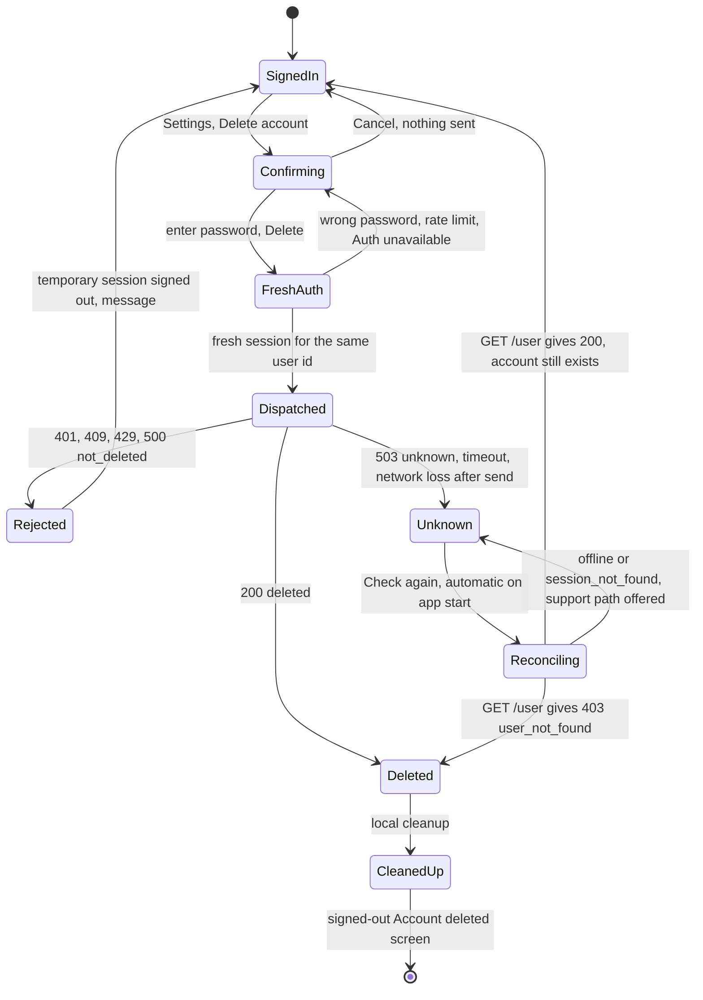

# Account deletion, retention and privileged boundary — technical specification

**Version 0.1, 2026-11-19, draft for owner review and a focused Codex follow-up review.** Implementation, migrations, Edge Function deployment and destructive tests are not authorized.

**Sources:**
- the [Slice 3 decision record](2026-11-19-slice-3-decision-record.md), section 6 (KAN-57, option B);
- the Codex account-lifecycle review (H1, H2, H5, M1, M2, M3) and its follow-up, held in ignored `.verification/account-spec-review-20261119/`;
- [the account-lifecycle overview](2026-11-19-account-lifecycle-overview.md), which holds the threat model, dispositions, provider assumptions, owner decisions and sequence.

**Tickets:**
- [KAN-43](https://michaelwuerthner.atlassian.net/browse/KAN-43), the parent;
- [KAN-57](https://michaelwuerthner.atlassian.net/browse/KAN-57), this contract;
- [KAN-58](https://michaelwuerthner.atlassian.net/browse/KAN-58) and [KAN-59](https://michaelwuerthner.atlassian.net/browse/KAN-59), the implementation;
- [KAN-72](https://michaelwuerthner.atlassian.net/browse/KAN-72), public content.

**Status tags:** as in the [password spec](2026-11-19-password-recovery-session-spec.md): [Settled], [Specified], [Feasibility FV-x], [Owner OD-x], [Blocked].

## 1. Provider and schema facts

These were verified by reading the source. Execution is not verified.

| Fact | Source |
|---|---|
| Admin hard delete runs in **one database transaction**: it inserts an audit entry (`user_id`, `user_email`, `user_phone`) and then `tx.Destroy(user)`, which deletes the `auth.users` row. Any error rolls back both, and the API answers with an error ("Database error deleting user", 500). `should_soft_delete` defaults to false. | [admin.go@v2.197.0](https://raw.githubusercontent.com/supabase/auth/v2.197.0/internal/api/admin.go) `adminUserDelete` |
| Authenticated Auth endpoints answer 403 `user_not_found` for a deleted user (checked before the session) and 403 `session_not_found` for a deleted session. | `api/auth.go` `maybeLoadUserOrSession` |
| Access tokens carry `sub`, `session_id` and `amr` `[{method, timestamp}]`. A password sign-in creates a new session with a `password` entry. A refresh keeps the stored entries. | `tokens/service.go`, `models/amr.go` |
| `public.profiles.id` → `auth.users`, cascade. | `00001_first_slice.sql:12` |
| `public.pantry_households.owner_id` → `auth.users`, cascade. No uniqueness on `owner_id`. | `00001:26` |
| `public.pantry_household_members`: `household_id` → households (cascade); `user_id` → `auth.users` (cascade); `role text DEFAULT 'owner'` with no CHECK; `UNIQUE(user_id)`. One membership per user does **not** mean one member per household. | `00001:35–39` |
| `public.pantry_items`: `household_id` → households (cascade); `created_by` → `auth.users` ON DELETE SET NULL. | `00001`, `00002:17–21` |
| `public.pantry_shopping_items`: `household_id` cascade; `created_by` SET NULL; `(household_id, pantry_item_id)` → pantry ON DELETE SET NULL (pantry_item_id). | `00004:12–31` |
| Signup creates one profile, one owned household and one owner membership through triggers. This is not a database-wide invariant. | `00001` `handle_new_user`, `handle_new_profile` |
| Clients have no write grants on households or memberships; only privileged roles can change them. | `00001`/`00002` grants and policies |
| No Supabase Storage is used by the app. | grep of `lib/` and `app/` |
| Existing tests deliberately hard-delete an *author* whose rows live in another household and expect `created_by` to become null: `tests/database.test.cjs:133`, `supabase/tests/database/shopping.test.sql:87–90`, `tests/integration/behavior.integration.ts:251–258`. Fixture cleanup deletes users through the Admin API. | repository |

## 2. Architecture

**[Settled]:**
- one narrow Supabase Edge Function, `delete-account`;
- the supported Auth Admin API with hard delete;
- no general backend;
- the service-role key only in the function's environment.

**[Specified], two small database additions** in one migration, written after feasibility verification:

1. **`public.account_deletion_requests`**
   - Columns:
     - `user_id uuid PRIMARY KEY REFERENCES auth.users(id) ON DELETE CASCADE`;
     - `state text CHECK (state IN ('idle','in_progress'))`;
     - `request_id uuid`;
     - `started_at timestamptz`;
     - `attempts_window_start timestamptz`;
     - `attempts int`.
   - Row level security is on with no policies. Grants go only to `service_role`; there is no access for `anon` or `authenticated`.
   - Purpose:
     - **serialization**: one in-flight deletion per user;
     - **per-user attempt limiting**;
     - **the commit-time guard's activation marker**.
   - The row disappears with the user through the cascade.
2. **Guard trigger `pf_guard_account_deletion`**
   - `BEFORE DELETE ON auth.users FOR EACH ROW`.
   - Function: `private.guard_account_deletion()`, `SECURITY DEFINER`, `SET search_path = ''`, owned by `postgres`, `EXECUTE` revoked from all client roles.
   - When the deleted user has an `account_deletion_requests` row with `state = 'in_progress'` and `started_at > now() - interval '5 minutes'`, the trigger:
     - locks the graph;
     - checks it (section 4);
     - raises `PF_DELETION_INELIGIBLE` when the check fails. That aborts Auth's transaction: nothing is deleted, including the audit entry.
   - Deletions without an active request (operators, test fixtures, the existing author-deletion semantics) are unchanged. [Owner OD-B2]
   - Placing a trigger on `auth.users` in hosted Supabase is [Feasibility FV-B1]. The project already has an `AFTER INSERT` trigger there (`on_auth_user_created`).

**Why the guard sits in the database and is conditional:**
- An eligibility check in the function followed by a separate `admin.deleteUser` is not atomic.
- Locks taken in one RPC end with that RPC.
- The guard therefore runs inside the very transaction that deletes the user.
- It activates only for self-service requests, so the Slice 1–2 database semantics that existing tests pin stay intact.
- An unconditional guard would also be possible. It would turn every author-deletion test and fixture cleanup with an unusual graph into a failure, and it is listed under OD-B2.
- The alternative of a direct SQL function (deleting `auth.users` from a service-role-only RPC, with the check in the same transaction) bypasses Auth's audit entry and lifecycle. It stays an alternative only if FV-B1 fails.

## 3. Caller identity and fresh authentication

**[Owner OD-B1]. Two candidate mechanisms; recommended: B.**

| | A: password checked inside the function | **B: fresh sign-in by the app, verified by the function** |
|---|---|---|
| How | The app sends the current password to the function. The function signs in with an isolated non-persisting Auth client, checks that the returned id equals the caller, deletes, then signs the temporary session out. | The app signs in again with an isolated non-persisting client (memory storage, `persistSession: false`, `autoRefreshToken: false`, `detectSessionInUrl: false`) using the current account's email and the entered password. It sends that fresh session's access token as the bearer. The function verifies the token and its freshness. |
| Password handling | The password passes through an extra server hop, with log-hygiene risk. | The password goes only to Auth, exactly like a normal sign-in. |
| Rate limiting | Auth's limiter sees the **function's** address for every user. That creates a shared bucket: anyone can exhaust deletion checks for all users, and per-attacker limits are lost. It needs function-side per-user limits *and* [Feasibility] on Auth's keying. | Auth's sign-in limiter sees the **phone's** address, as at normal login. The function adds per-user request limits. |
| Temporary credentials | Created in the function and must be cleaned up there. | The fresh session belongs to the app. The hard delete removes it on success; the app signs it out on rejection. |
| Freshness proof | The direct password check. | `amr` contains `password` with `timestamp ≥ now − 300 s`, on a session that still exists. A refreshed token keeps its old `amr` timestamp, so a stolen refresh token cannot produce a fresh entry. A client flag or `iat` is never used. |

**[Specified] for B.** The function rejects with 401 `not_fresh` unless all of these hold:
1. The gateway JWT verification passes (`verify_jwt = true`).
2. `auth.getUser(token)` succeeds, which proves that the user **and** the session still exist (403 `user_not_found` / `session_not_found` → 401).
3. The caller is `getUser().user.id`, and the token's `sub` equals it. The target is always the caller.
4. The request body is empty JSON `{}`. Any field, including a user id or email, gives 400 `unexpected_field`; there is no client-supplied target.
5. The token's `amr` contains a `password` entry with `timestamp ≥ now − 300 s`. A just-recovered user satisfies this by entering the new password, since a `recovery` entry does not count.

**Also specified:**
- **Logging:** the function logs only `request_id`, the outcome code and the duration. It never logs headers, tokens, passwords or emails.
- **Wrong password:** fails at the app's sign-in with "Password is incorrect" (generic).
- **Auth unavailable:** "We couldn't verify your password. Nothing was deleted."

## 4. Eligible household graph and the commit-time guard

### 4.1 Eligibility for caller U (Slice 3)

**[Specified] from the owner's preferred contract.**

| Rule | Condition | Failure code |
|---|---|---|
| G1 | Exactly one `pantry_households` row with `owner_id = U`; call it H | `no_household` / `multiple_households` |
| G2 | Exactly one `pantry_household_members` row with `household_id = H`, and it is `(user_id = U, role = 'owner')` | `extra_members` / `membership_mismatch` |
| G3 | U's membership row (at most one, by `UNIQUE(user_id)`) exists and has `household_id = H` | `membership_mismatch` |
| G4 | No `pantry_items` and no `pantry_shopping_items` with `created_by = U` and `household_id ≠ H` | `foreign_attribution` |

**Ineligible graphs fail closed:**
- The function returns 409 with the code. The app shows: "Your account can't be deleted automatically. Contact support." No other user's details are revealed.
- **Support repair procedure:**
  - Inspect the graph by UUID.
  - Agree the repair with the owner.
  - Any data change follows a reviewed SQL script, recorded with date and UUID only.
  - The user then retries.
- In today's app these graphs arise only from privileged fixtures or legacy data.

### 4.2 Guard algorithm

```text
BEFORE DELETE ON auth.users, row OLD:
  if not exists active request for OLD.id: return OLD        -- unguarded path, unchanged semantics
  -- OLD's auth.users row is already locked (FOR UPDATE-strength) by the DELETE before row triggers run
  lock: SELECT id FROM public.pantry_households WHERE owner_id = OLD.id ORDER BY id FOR UPDATE
  lock: SELECT id FROM public.pantry_household_members
          WHERE household_id IN (those ids) OR user_id = OLD.id ORDER BY id FOR UPDATE
  evaluate G1–G4 with fresh statements (READ COMMITTED: each sees rows committed before its lock wait ended)
  if any fails: RAISE EXCEPTION 'PF_DELETION_INELIGIBLE' USING DETAIL = <code>
  return OLD                                                   -- cascades follow in the same transaction
```

### 4.3 Concurrency argument

[Feasibility FV-B2] must prove each of the following with deterministic interleavings.

| Competing operation | Lock it needs | Interaction | Outcome |
|---|---|---|---|
| Insert a membership into H for another user V | `KEY SHARE` on H (FK check) | Conflicts with the guard's `FOR UPDATE` on H | Committed before the guard's lock: the guard sees it and aborts (`extra_members`). Started after: it waits, then fails its FK because H was deleted. |
| Move V's membership into H (`UPDATE … SET household_id = H`) | `KEY SHARE` on H | Same | Same |
| Change H's owner | Row lock on H | Conflicts | Serialized; the guard re-evaluates after the wait |
| Create a second household owned by U | `KEY SHARE` on U's `auth.users` row | Conflicts with the DELETE's row lock | Committed first: the guard sees two households and aborts. Otherwise it waits, then fails its FK. |
| Insert an item or shopping row elsewhere with `created_by = U` | `KEY SHARE` on U's row | Same | Committed first: `foreign_attribution` aborts. Otherwise it waits, then fails its FK. |
| Concurrent self-service deletion for U | `account_deletion_requests` row update | The function's conditional update admits one `in_progress` request | The second gets 409 `in_progress`, or 401 once U is gone |

**Further rules:**
- **Isolation assumption:** Auth's default READ COMMITTED. Under REPEATABLE READ a lock conflict can raise a serialization failure, which is a confirmed rejection.
- **Deadlocks:**
  - The guard's lock order is user row → households (by id) → memberships (by id).
  - A privileged writer locking in another order can deadlock. PostgreSQL then aborts one transaction. If the guard's transaction is aborted, the deletion is a confirmed rejection and the user may retry.
  - **Maintenance rule:** privileged writers touching ownership, membership or attribution lock in the same order, or run while self-service deletion is paused. Pausing means the function returns 503 `maintenance` while a flag row exists; that is [Owner OD-B6].
- **Rollback:** the exception aborts the whole Auth transaction, including the audit entry. Cascades already applied inside it are undone.
- **A count-only check is insufficient** without these row locks. That is why the guard locks before counting.

## 5. Request protocol and state machine

### 5.1 Function steps

1. Verify the caller and freshness (section 3); a failure returns 401.
2. Upsert `account_deletion_requests` for U in one statement:
   - reset the attempt window after 24 h;
   - reject with 429 `rate_limited` when `attempts ≥ 5` in the window;
   - reject with 409 `in_progress` when `state = 'in_progress'` and `started_at > now() − 5 min`;
   - otherwise set `state = 'in_progress'`, a new `request_id`, `started_at = now()` and `attempts + 1`.

   **[Specified]** The limits are [Owner OD-B3]: proposed 5 per 24 h, with a 5-minute in-flight window.
3. Eligibility pre-check (section 4.1) with service privileges, for a clear error. If ineligible: set `state = 'idle'` and return 409 with the code. The trigger re-checks at commit.
4. Call `admin.deleteUser(U)`; it is a hard delete.
5. Map the result:

   | Auth response | Function response |
   |---|---|
   | 200 | 200 `deleted` (the request row is gone with U) |
   | Auth JSON error (4xx/5xx with an Auth error body) | The transaction rolled back. Set `state = 'idle'`. If the error is the guard's exception, return 409 `ineligible_changed`; otherwise 500 `not_deleted`. If FV-B5 shows the Admin API hides the guard's text, the function re-runs the section 4.1 check after the rollback: ineligible now → 409 `ineligible_changed`, else 500 `not_deleted`. |
   | Timeout, connection reset, or a gateway 5xx without an Auth body | Reconcile once with `admin.getUserById(U)`: 404 → 200 `deleted`; found → set `idle` and return 500 `not_deleted`; reconciliation failed → 503 `unknown` |

   Reconciliation is read-only. The function never resends the delete.

### 5.2 App state machine



| State | Behavior |
|---|---|
| **Confirming** | One disclosure, then the password field and a destructive **Delete account** button. The disclosure says what is deleted (account, household, pantry and shopping lists), that it is permanent, that other signed-in devices lose access within an hour and keep any offline copy until they reconnect, and what remains in operational records (section 7). Cancel sends nothing. There is no typed confirmation phrase. |
| **FreshAuth** | Isolated client sign-in (section 3). It asserts that the fresh session's user id equals the main session's user id; otherwise it aborts and signs the fresh session out. |
| **Dispatched** | The button is disabled and there is no cancel, because a dispatched request cannot be recalled. One request per tap. |
| **Rejected** | Nothing changed. The app signs out the temporary session (`signOut({ scope: 'local' })` on the isolated client). Messages by code: `not_fresh` ("Please enter your password again"), `in_progress`, `rate_limited`, ineligible ("Contact support"), `not_deleted` ("Nothing was deleted. Try again later."). |
| **Unknown** | Persist `pf.deletion.unknown = {user_id, at}` (not secret) and drop the temporary session from memory. Show "We couldn't confirm whether your account was deleted." It is never retried automatically. Starting a new deletion requires Reconciling to end in SignedIn first. |
| **Reconciling** | Read-only `GET /user` with the main session, which is a different session from the temporary one: `user_not_found` → Deleted; 200 → SignedIn ("Your account was not deleted") and the flag is cleared; `session_not_found` or offline → stays Unknown, offering "Check again" and the support contact. It runs again on every app start while the flag exists. |
| **CleanedUp** | `signOut({ scope: 'local' })` on the main client; it tolerates errors, because the server already removed the sessions. Remove the PantryFlow AsyncStorage keys (session, verifiers, markers, unknown flag; the language preference may stay), reset the providers' in-memory household lists, and route to "Your account was deleted". Late in-flight responses are dropped by the existing scope guards (`isCurrent`). |

### 5.3 Further cases

- **Duplicate taps:** the button is disabled, and the server request row serializes requests.
- **Two devices:** the second gets 409 `in_progress`, or 401 after completion.
- **Replay of a captured fresh token:** after deletion, 401 because the user is gone. Before deletion, an attacker needs the token within 5 minutes plus a valid session; that is equivalent to a stolen fresh login and is documented as a residual risk.
- **Re-registration with the same email:** gets a new UUID. Nothing is keyed by email, so old request rows and flags cannot affect it. The local unknown flag compares `user_id`.
- **Offline other devices:** lose server access once their JWT expires (≤ 3600 s; PostgREST data access ends at once in practice, because the memberships are gone) and the refresh fails. Their local cache is cleared on their next authenticated refresh failure. **No promise of remote erasure of an offline device.**

## 6. Table-by-table hard-deletion contract

All of this happens in Auth's single deletion transaction, after the guard passes for an eligible graph.

| Data | Effect | Verified by |
|---|---|---|
| `auth.users` (U) | Deleted | D05 |
| `auth.identities`, `auth.sessions`, `auth.refresh_tokens`, `auth.mfa_factors`, `auth.mfa_amr_claims`, `auth.one_time_tokens` | Removed by Auth's FK cascades. [Feasibility FV-B3]: confirm each FK in the deployed auth schema. | D05, D12 |
| `auth.flow_state` rows of U | [FV-B3]: confirm FK or expiry behavior | D05 |
| `auth.audit_log_entries` | **Retained.** Earlier entries plus the new `user_deleted` entry with user id, email and phone. There is no FK. See the retention table. | Retention R-2 |
| `public.profiles` (U) | Cascade-deleted | D05 |
| `public.pantry_households` (H) | Cascade-deleted | D05 |
| `public.pantry_household_members` (U's, the only row of H) | Cascade-deleted | D05 |
| `public.pantry_items` in H | Cascade-deleted | D05 |
| `public.pantry_shopping_items` in H | Cascade-deleted; links inside H vanish with the rows | D05 |
| Rows elsewhere with `created_by = U` | None exist (G4) | D06 |
| `public.account_deletion_requests` (U) | Cascade-deleted | D05 |
| Storage | Not used; nothing to delete | — |
| Device-local data (this installation) | Cleared by CleanedUp | D13 |
| Other users' rows | Unchanged, byte for byte | D04, D05 |

Application data is **never** deleted in a separate request before the Auth user.

## 7. Retention inventory and restoration

No periods are invented. "Unverified" means it needs a plan or settings read (authorized) or a legal review.

| ID | Category | Data | Role | Period | Deletion mechanism | Justification | Status |
|---|---|---|---|---|---|---|---|
| R-1 | Live application data | Profile, household, pantry, shopping | PantryFlow (controller); Supabase (processor) | Until account deletion | Section 6 | Service | Specified |
| R-2 | Auth audit log | User id, email, phone, IP, actions | Same | Unverified: in-database table with no automatic expiry known; platform log retention by plan | None today. [Owner OD-B4]: periodic purge of entries older than N days, or keep | Security investigation | Unverified, owner decision |
| R-3 | Supabase platform logs (API, Auth, function) | Request metadata, IPs, no bodies | Supabase (processor) | Unverified (plan-dependent) | Expiry | Operations | Unverified |
| R-4 | Database backups / PITR | Everything in R-1 and R-2 at backup time | Supabase (processor) | Unverified (plan-dependent) | Expiry; restore procedure below | Disaster recovery | Unverified |
| R-5 | Resend delivery records | Recipient email, subject, delivery events | Resend (processor) | Unverified (Resend plan) | Expiry or Resend deletion request | Delivery troubleshooting | Unverified, legal review |
| R-6 | Sentry (future, OPS-01) | Scrubbed crash data, no email | Sentry (processor) | Unverified until OPS-01 | Expiry; per-user deletion only if user ids are ever attached (not planned) | Crash diagnosis | Pending OPS-01 |
| R-7 | Device-local storage | Session, cache, preferences | User's device | Until cleanup or uninstall | CleanedUp on this device; other devices on their next refresh failure | — | Specified |
| R-8 | Support and external requests | Email thread, UUID, outcome | PantryFlow | [Owner OD-B4] | Manual | Proof of fulfillment | Owner decision |

**Restoration [Specified with Owner OD-B5]:**
1. A backup is restored only into an **isolated** project first, never directly into production access.
2. Before access opens, every deletion completed after the backup's timestamp is re-applied by UUID.
3. **Source of those UUIDs:** an out-of-band deletion ledger. The recommended form is that the function sends one notification per completed deletion to the owner's support mailbox, containing only the UUID and the UTC time. That record lives outside the database, so a restore can't roll it back. Its retention must exceed the backup retention.
4. **Alternative:** the platform logs, valid only within their retention window. If the gap exceeds that window, the restore is blocked pending an owner or legal decision.
5. Re-applying uses the same Admin delete. An ineligible graph after restore is handled by the support repair procedure.

**External deletion requests** (no app access) **[Specified]:**
- **Request channel:** the support email published under KAN-72. It is also the web deletion route Google Play requires.
- **Identity check:** the request must come from the account's email address, and the requester confirms by replying to our acknowledgement, which proves mailbox control. App access is never required.
- **Execution:**
  - The operator looks up the UUID once by email at intake and from then on uses only the UUID.
  - The operator inserts an `in_progress` request row, so the guard applies, then runs the Admin delete.
  - The operator records date, UUID and outcome (R-8).
- **Timing:** a reply within the period stated in the privacy notice (KAN-72, legal review).

**Technical guarantees versus legal requirements:**
- This spec states technical behavior.
- These need a separate legal review, which this spec does not provide:
  - whether the retained categories (R-2 to R-5, R-8) and their periods satisfy GDPR and store policy;
  - the response deadlines.

## 8. Tests

These are proposed tests, not a claim that any currently passes. Destructive and concurrency tests run only in a disposable stack. Mocked Admin calls alone are not accepted as proof.

| ID | Requirement | Oracle | Layer |
|---|---|---|---|
| D01 | Missing, malformed or expired bearer | 401; nothing deleted | Function integration |
| D02 | Stolen or refreshed bearer without a fresh password | Token whose `amr` password entry is older than 300 s → 401 `not_fresh`; a client flag in the body → 400 | Function + Auth |
| D03 | Wrong password or Auth outage | App sign-in fails; the function is never called; no temporary session leaks | Comp + Auth |
| D04 | A targets B | Body `{user_id: B}` → 400; B's graph unchanged byte for byte | Function + DB |
| D05 | Eligible hard delete | Every section 6 row matches; B's data unchanged; U's refresh fails; `getUserById(U)` → 404 | Real Auth + DB |
| D06 | Ineligible graphs | Each G1–G4 failure → 409 with its code; nothing deleted (all rows and the audit table unchanged) | Fixture graphs + function |
| D07 | Membership race | Deterministic interleavings with two DB connections and `pg_locks` polling: (a) T2 inserts a membership into H and holds it; T1's guarded DELETE blocks; T2 commits; T1 aborts `extra_members`; full rollback. (b) T1's guarded DELETE holds its locks; T2's insert blocks; T1 commits; T2 fails its FK. | DB, plus one Admin API end-to-end |
| D08 | Ownership, second household and foreign attribution races; deadlock | The same method for each section 4.3 row; a forced deadlock aborts one side without a partial state | DB |
| D09 | Duplicate and replay | Concurrent calls: one `in_progress`, the other 409; replay after deletion → 401 | Function |
| D10 | Failure before commit | Guard exception, or an injected FK failure → 500/409; full graph intact | DB + function |
| D11 | Commit, then lost response | The proxy drops the function's 200 → app Unknown → Reconciling → `user_not_found` → Deleted; re-registering the same email afterwards is unaffected | Function + Comp + Auth |
| D12 | Stale tokens after deletion | Old JWT: PostgREST returns no pantry, shopping or profile rows (memberships gone); Auth `GET /user` → `user_not_found`; refresh fails; the function → 401 | Multi-client API |
| D13 | Local cleanup | After Deleted, restart shows the signed-out screen; no cached rows; late responses dropped | Comp + Native |
| D14 | UX | Cancel before dispatch has no effect; no cancel after; errors announced; English and German; TalkBack | Comp + Native |
| D15 | Unguarded paths unchanged | The existing author-deletion tests (`database.test.cjs`, `shopping.test.sql`, `behavior.integration.ts`) and fixture cleanup pass unmodified | Existing suites |
| V01 | Diagnostics | Function logs and crash payloads contain no password, token, authorization header or email | Review + test |
| V02 | Restore rehearsal | Disposable restore → re-apply the ledger UUIDs → deleted accounts absent before access opens | Operational exercise |
| V03 | External request | The runbook is executed on a fixture account; the identity check is recorded; another user is unaffected | Manual |
| G01 | Regression | Signup, confirmation, login, CRUD and household-isolation suites green | Existing suites |

**Feasibility verification items** (separate authorization; disposable environment):

| ID | What it checks |
|---|---|
| FV-B1 | A `BEFORE DELETE` trigger on `auth.users` works locally and is permitted on hosted Supabase, and its exception surfaces through the Admin API as described. |
| FV-B2 | The lock semantics in section 4.3 (D07, D08). |
| FV-B3 | The auth-schema FK cascades of the deployed version. |
| FV-B4 | The `amr` password timestamp on a fresh isolated sign-in, its retention across refresh, and the Edge gateway's JWT verification exposing `amr` to the function. |
| FV-B5 | How the Admin API reports the guard exception (status and body), for the step 5 mapping. |

## 9. Slice 4 compatibility

These assumptions must be replaced, not relaxed, before sharing is enabled:

- **Owner deletion with other members:** today G2 rejects it. Slice 4 must choose between ownership transfer and household deletion with member notice, and only then change G2.
- **Ownership transfer:** a new privileged write path that must take the guard's lock order.
- **Non-owner member deletion:** today G1 rejects it (no owned household). Slice 4 must define leaving the household, keeping shared rows with `created_by` set to null, and how the member's attribution is presented.
- **Invitations:** pending invitations to or from U need a defined cascade or revocation. No invitation table exists today.
- **Historical attribution:** G4 becomes a real branch once rows in shared households carry U as creator. The SET NULL semantics already pinned by tests are the likely basis.
- **Concurrent membership operations:** every new membership writer obeys section 4.3's lock order, and the deterministic race tests extend to it.

The present guard stays fail-closed until a reviewed Slice 4 contract replaces it.
