# Account deletion, retention and privileged boundary — technical specification

**Version 0.5, 2026-11-19, responding to the Codex review of `f1028869` (`docs/reviews/2026-11-19/specs-v0.4-review.md`).**

**Changes in 0.5** (Codex N1, N2, N5, N6, N8, OD-B6):
- **Guard activation never expires (N1).** A self-service request row is `pending` (guarded) or `fenced` (deletion refused). Only users who never had a request row take the unguarded administrative path, and time never grants an exemption (§2).
- **Fence-then-lookup quiescence protocol (N2).** A fencing update waits for any deletion that is mid-commit, so a later "user exists" is terminal. It's used by the function after errors, by a new status call for app reconciliation, by a second request, and by maintenance draining (§5.1, §5.2).
- **Crash-safe deletion ledger (N5):** an intent message is sent *before* dispatch and an outcome message after; Resend idempotency keys; unresolved intents block restoration (§7).
- **External requests (N6):** an unpredictable, expiring, single-use challenge (§7).
- **One temporary-session lifecycle (N8)** (§3, §5.2).
- **Maintenance pause drains in-flight requests (OD-B6)** (§4.3).

**Version 0.3, 2026-11-19, for the focused Codex follow-up review.** Implementation, migrations, Edge Function deployment and destructive tests are not authorized.

**Changes in 0.3:** runtime results from the [feasibility evidence](../testing/2026-11-19-account-lifecycle-feasibility.md) are folded in.
- FV-B1, B2, B3 and B4: confirmed.
- FV-B5: supabase-js hides the guard's error, so the function reconciles after *any* non-200 response (section 5.1).
- FV-B3: `auth.flow_state` rows stay behind after deletion (sections 6 and 7).

**Changes in 0.2** (owner decisions of 2026-11-19):
- OD-B1 conditionally approved: exact claim checks, temporary-session behavior, and verification of the rate-limit advantage (section 3).
- OD-B2 conditionally approved: trusted activation context, why it can't be bypassed, and exempted operations (section 2.1).
- OD-B5 requirement approved and the ledger designed (section 7).

**Sources:**
- the [Slice 3 decision record](2026-11-19-slice-3-decision-record.md), section 6 (KAN-57, option B);
- the Codex account-lifecycle review (H1, H2, H5, M1, M2, M3) and its follow-up, in [`docs/reviews/2026-11-19/`](../reviews/2026-11-19/);
- [the account-lifecycle overview](2026-11-19-account-lifecycle-overview.md), which holds the threat model, dispositions, provider assumptions, owner decisions and sequence.

**Tickets:**
- [KAN-43](https://michaelwuerthner.atlassian.net/browse/KAN-43), the parent;
- [KAN-57](https://michaelwuerthner.atlassian.net/browse/KAN-57), this contract;
- [KAN-58](https://michaelwuerthner.atlassian.net/browse/KAN-58) and [KAN-59](https://michaelwuerthner.atlassian.net/browse/KAN-59), the implementation;
- [KAN-72](https://michaelwuerthner.atlassian.net/browse/KAN-72), public content.

**Status tags:** as in the [password spec](2026-11-19-password-recovery-session-spec.md): [Settled], [Specified], [Feasibility FV-x], [Owner OD-x], [Blocked].

## 1. Provider and schema facts

These were verified by reading the source. Execution is not verified.

| Fact | Source |
|---|---|
| Admin hard delete runs in **one database transaction**: it inserts an audit entry (`user_id`, `user_email`, `user_phone`) and then `tx.Destroy(user)`, which deletes the `auth.users` row. Any error rolls back both, and the API answers with an error ("Database error deleting user", 500). `should_soft_delete` defaults to false. | [admin.go@v2.197.0](https://raw.githubusercontent.com/supabase/auth/v2.197.0/internal/api/admin.go) `adminUserDelete` |
| Authenticated Auth endpoints answer 403 `user_not_found` for a deleted user (checked before the session) and 403 `session_not_found` for a deleted session. | `api/auth.go` `maybeLoadUserOrSession` |
| Access tokens carry `sub`, `session_id` and `amr` `[{method, timestamp}]`. A password sign-in creates a new session with a `password` entry. A refresh keeps the stored entries. | `tokens/service.go`, `models/amr.go` |
| `public.profiles.id` → `auth.users`, cascade. | `00001_first_slice.sql:12` |
| `public.pantry_households.owner_id` → `auth.users`, cascade. No uniqueness on `owner_id`. | `00001:26` |
| `public.pantry_household_members`: `household_id` → households (cascade); `user_id` → `auth.users` (cascade); `role text DEFAULT 'owner'` with no CHECK; `UNIQUE(user_id)`. One membership per user does **not** mean one member per household. | `00001:35–39` |
| `public.pantry_items`: `household_id` → households (cascade); `created_by` → `auth.users` ON DELETE SET NULL. | `00001`, `00002:17–21` |
| `public.pantry_shopping_items`: `household_id` cascade; `created_by` SET NULL; `(household_id, pantry_item_id)` → pantry ON DELETE SET NULL (pantry_item_id). | `00004:12–31` |
| Signup creates one profile, one owned household and one owner membership through triggers. This is not a database-wide invariant. | `00001` `handle_new_user`, `handle_new_profile` |
| Clients have no write grants on households or memberships; only privileged roles can change them. | `00001`/`00002` grants and policies |
| No Supabase Storage is used by the app. | grep of `lib/` and `app/` |
| Existing tests deliberately hard-delete an *author* whose rows live in another household and expect `created_by` to become null: `tests/database.test.cjs:133`, `supabase/tests/database/shopping.test.sql:87–90`, `tests/integration/behavior.integration.ts:251–258`. Fixture cleanup deletes users through the Admin API. | repository |

## 2. Architecture

**[Settled]:**
- one narrow Supabase Edge Function, `delete-account`;
- the supported Auth Admin API with hard delete;
- no general backend;
- the service-role key only in the function's environment.

**[Specified], two small database additions** in one migration, written after feasibility verification:

1. **`public.account_deletion_requests`**
   - Columns:
     - `user_id uuid PRIMARY KEY REFERENCES auth.users(id) ON DELETE CASCADE`;
     - `state text NOT NULL CHECK (state IN ('pending','fenced'))`;
     - `request_id uuid NOT NULL`;
     - `started_at timestamptz NOT NULL`;
     - `attempts_window_start timestamptz`;
     - `attempts int`.
   - Row level security is on with no policies. Grants go only to `service_role`; there is no access for `anon` or `authenticated`.
   - **Rows are never deleted by the function.** A row disappears only with the user, through the cascade in the committed deletion. Removing one otherwise is an owner-approved maintenance action.
   - Purpose:
     - **guard activation**, without any time component;
     - **fencing**;
     - **serialization**;
     - **per-user attempt limiting**.
2. **Guard trigger `pf_guard_account_deletion`**
   - `BEFORE DELETE ON auth.users FOR EACH ROW`.
   - Function: `private.guard_account_deletion()`, `SECURITY DEFINER`, `SET search_path = ''`, owned by `postgres`, `EXECUTE` revoked from all client roles.
   - Behaviour by row state:

     | Request row for OLD.id | Guard behaviour |
     |---|---|
     | `pending` | Lock the row `FOR SHARE`, then lock and check the graph (section 4). On failure, raise `PF_DELETION_INELIGIBLE`. |
     | `fenced` | Raise `PF_DELETION_FENCED`: deletion refused. |
     | None | Unguarded, existing semantics: the administrative and test path of §2.1. |

   - **No time condition exists.** A `pending` request delayed by any amount stays guarded, and a fenced one stays refused (N1).
   - The `FOR SHARE` lock on a `pending` row is what lets fencing wait for a deletion that is mid-commit (§5.1).
   - Placing a trigger on `auth.users` in hosted Supabase is [Feasibility FV-B1]. The project already has an `AFTER INSERT` trigger there (`on_auth_user_created`).

### 2.1 Trusted activation context

**[Conditionally approved, OD-B2, 2026-11-19].**

**How the context reaches Auth's transaction:**
1. The function, holding the service-role key, commits the `pending` row in its own short transaction **before** it calls the Admin API.
2. Auth's deletion transaction then runs the trigger, which reads that committed row (READ COMMITTED) inside the same transaction that deletes the user.
3. No request parameter, header, claim or session setting is used. The Admin API offers no way to pass context into its transaction, and none is needed.

**Why ordinary callers can't forge or bypass it:**
- `anon` and `authenticated` have no grants on `account_deletion_requests`, and row level security is enabled with no policies. A client can neither create nor delete a row: verified by tests D16 and D17.
- Clients cannot delete `auth.users` at all, because they have no SQL grants and the Admin API requires the service-role key. So "bypassing" the guard means deleting a user **who never had a request row**, which only a privileged operator can do. A self-service request can never lose its row except by its own committed deletion. Therefore a self-service operation can never fall onto the unguarded path, whether it is delayed, expired or unresolved (N1).
- Activation can only make a deletion stricter. A forged row, if one could exist, would block the deletion, never permit it.

**Explicitly exempted operations** (guard inactive, existing semantics; each is privileged):

| Operation | Who | Rule |
|---|---|---|
| Disposable or local test fixtures and their cleanup (`local-stack.ts`, `e2e-fixtures.ts`, the existing author-deletion tests) | Test harness with the local service key | Local and disposable environments only |
| Operator deletion through the dashboard or Admin API of a user with **no** request row | Owner or operator | **Not used for user-requested deletions.** User-requested and external requests always insert a `pending` row first (section 7). Allowed only for test or legacy accounts, with an owner-approved, recorded reason. A user who has ever had a row can only be deleted through the guarded path |
| Database maintenance as `postgres` or `supabase_admin` | Owner or operator | Follows the lock-order rule (section 4.3) or the maintenance pause (OD-B6) |

**Why the guard sits in the database and is conditional:**
- An eligibility check in the function followed by a separate `admin.deleteUser` is not atomic.
- Locks taken in one RPC end with that RPC.
- The guard therefore runs inside the very transaction that deletes the user.
- It activates only for self-service requests, so the Slice 1–2 database semantics that existing tests pin stay intact.
- An unconditional guard would also be possible. It would turn every author-deletion test and fixture cleanup with an unusual graph into a failure, and it is listed under OD-B2.
- The alternative of a direct SQL function (deleting `auth.users` from a service-role-only RPC, with the check in the same transaction) bypasses Auth's audit entry and lifecycle. It stays an alternative only if FV-B1 fails.

## 3. Caller identity and fresh authentication

**[Owner OD-B1]. Two candidate mechanisms; recommended: B.**

| | A: password checked inside the function | **B: fresh sign-in by the app, verified by the function** |
|---|---|---|
| How | The app sends the current password to the function. The function signs in with an isolated non-persisting Auth client, checks that the returned id equals the caller, deletes, then signs the temporary session out. | The app signs in again with an isolated non-persisting client (memory storage, `persistSession: false`, `autoRefreshToken: false`, `detectSessionInUrl: false`) using the current account's email and the entered password. It sends that fresh session's access token as the bearer. The function verifies the token and its freshness. |
| Password handling | The password passes through an extra server hop, with log-hygiene risk. | The password goes only to Auth, exactly like a normal sign-in. |
| Rate limiting | Auth's limiter sees the **function's** address for every user. That creates a shared bucket: anyone can exhaust deletion checks for all users, and per-attacker limits are lost. It needs function-side per-user limits *and* [Feasibility] on Auth's keying. | Auth's sign-in limiter sees the **phone's** address, as at normal login. The function adds per-user request limits. |
| Temporary credentials | Created in the function and must be cleaned up there. | The fresh session belongs to the app. The hard delete removes it on success; the app signs it out on rejection. |
| Freshness proof | The direct password check. | `amr` contains `password` with `timestamp ≥ now − 300 s`, on a session that still exists. A refreshed token keeps its old `amr` timestamp, so a stolen refresh token cannot produce a fresh entry. A client flag or `iat` is never used. |

**[Conditionally approved, OD-B1, 2026-11-19]: B, if the proof is sufficient.** The function rejects with 401 `not_fresh` (or 401 `unauthenticated`) unless every check holds. Each check is independent of the app.

| # | Check | How |
|---|---|---|
| 1 | **Authenticity** | The JWT signature is verified against the project's Auth signing keys (the gateway's `verify_jwt = true` plus an in-function verification of the same token). Expected claims: `iss` is the project Auth URL, `aud` is `authenticated`, `role` is `authenticated`, `exp` in the future (60 s clock tolerance), `is_anonymous` false, `sub` a UUID, `session_id` a non-nil UUID. |
| 2 | **Current session and user** | `auth.getUser(token)` succeeds. Auth itself looks up the user, then the session named in the token (403 `user_not_found` / `session_not_found` → 401). |
| 3 | **Immutable identity** | The caller is `getUser().user.id`; it must equal `sub`. The target is always the caller. Email is never used for targeting. |
| 4 | **No client target** | The body is empty JSON `{}`; any field gives 400 `unexpected_field`. |
| 5 | **Password method, server-derived time, ≤ 300 s** | The verified token's `amr` contains an entry with `method === 'password'`, and that entry's `timestamp` satisfies `now − 300 ≤ timestamp ≤ now + 60`. The timestamp is written by Auth when it issues the session (`mfa_amr_claims.updated_at`) and signed into the token. The app supplies nothing for this check. |

**Why a refreshed token cannot renew the window:**
- A refresh issues a new access token from the session's stored `amr` entries and adds no new entry; `AddClaimToSession` runs only when a session is issued (`tokens/service.go`).
- The `password` timestamp therefore stays at the original sign-in time.
- `iat` is never used. [Feasibility FV-B4] verifies this at runtime.

**Why recovery, OTP and other sessions cannot satisfy it:**
- Only `method === 'password'` counts. `recovery`, `otp`, `magiclink`, `email/signup` and `token_refresh` entries are ignored.
- `amr` is per session, so another session's sign-in never appears in this token.
- A just-recovered user satisfies the check by signing in with the new password, which creates a new session.

**Temporary and replacement sessions** (the fresh session belongs to the isolated client and never replaces the main session):

| Situation | Behavior |
|---|---|
| Cancel during or after FreshAuth, before dispatch | The app signs the fresh session out (`signOut({ scope: 'local' })` on the isolated client), which revokes it server-side |
| Confirmed rejection | Same; the main session stays the active one |
| Confirmed deletion | Every session, the fresh one included, is gone with the user |
| Unknown (the single lifecycle; §5.2 uses the same) | The isolated client stays **in memory** until Reconciling reaches a terminal result. On `not_deleted`, the app signs the fresh session out (server revocation needs a connection; while offline it stays pending in memory). On `deleted`, nothing remains. If the app is closed or killed first, the fresh session is an orphan: its tokens existed only in memory, and the server row remains until the provider's session limits remove it. This residual is documented and covered by test D23. |

**Rate-limit advantage and residual risk** [Feasibility FV-B6]:
- **Claim:**
  - With B, password attempts reach Auth from the phone's address, so the per-address token limiter applies per attacker.
  - With A, every user's attempt would come from the function's egress address and share one bucket, unless Auth honors a forwarded client address.
- **To verify:** in the disposable stack, compare limiter behavior for direct sign-ins with sign-ins sent from inside a locally served function. For hosted keying, record it as a provider assumption, documented by Supabase or confirmed in the authorized read.
- **Residual risk, stated plainly:** an attacker who obtains a fresh token (for example, malware on the phone) within its 300-second window, while that session is alive, can trigger deletion. This is equivalent to having just stolen the password. The 5-per-24-hour request limit bounds repetition, not a single use.

**Also specified:**
- **Logging:** the function logs only `request_id`, the outcome code and the duration. It never logs headers, tokens, passwords or emails.
- **Wrong password:** fails at the app's sign-in with "Password is incorrect" (generic).
- **Auth unavailable:** "We couldn't verify your password. Nothing was deleted."

## 4. Eligible household graph and the commit-time guard

### 4.1 Eligibility for caller U (Slice 3)

**[Specified] from the owner's preferred contract.**

| Rule | Condition | Failure code |
|---|---|---|
| G1 | Exactly one `pantry_households` row with `owner_id = U`; call it H | `no_household` / `multiple_households` |
| G2 | Exactly one `pantry_household_members` row with `household_id = H`, and it is `(user_id = U, role = 'owner')` | `extra_members` / `membership_mismatch` |
| G3 | U's membership row (at most one, by `UNIQUE(user_id)`) exists and has `household_id = H` | `membership_mismatch` |
| G4 | No `pantry_items` and no `pantry_shopping_items` with `created_by = U` and `household_id ≠ H` | `foreign_attribution` |

**Ineligible graphs fail closed:**
- The function returns 409 with the code. The app shows: "Your account can't be deleted automatically. Contact support." No other user's details are revealed.
- **Support repair procedure:**
  - Inspect the graph by UUID.
  - Agree the repair with the owner.
  - Any data change follows a reviewed SQL script, recorded with date and UUID only.
  - The user then retries.
- In today's app these graphs arise only from privileged fixtures or legacy data.

### 4.2 Guard algorithm

```text
BEFORE DELETE ON auth.users, row OLD:
  -- OLD's auth.users row is already locked (FOR UPDATE-strength) by the DELETE before row triggers run
  SELECT state FROM public.account_deletion_requests WHERE user_id = OLD.id FOR SHARE   -- waits for a concurrent fence
  if no row: return OLD                                         -- administrative/test path, unchanged semantics
  if state = 'fenced': RAISE EXCEPTION 'PF_DELETION_FENCED'
  -- state = 'pending': guarded, regardless of age
  lock: SELECT id FROM public.pantry_households WHERE owner_id = OLD.id ORDER BY id FOR UPDATE
  lock: SELECT id FROM public.pantry_household_members
          WHERE household_id IN (those ids) OR user_id = OLD.id ORDER BY id FOR UPDATE
  evaluate G1–G4 with fresh statements (READ COMMITTED: each sees rows committed before its lock wait ended)
  if any fails: RAISE EXCEPTION 'PF_DELETION_INELIGIBLE' USING DETAIL = <code>
  return OLD                                                   -- cascades (including the request row) follow in the same transaction
```

### 4.3 Concurrency argument

[Feasibility FV-B2] must prove each of the following with deterministic interleavings.

| Competing operation | Lock it needs | Interaction | Outcome |
|---|---|---|---|
| Insert a membership into H for another user V | `KEY SHARE` on H (FK check) | Conflicts with the guard's `FOR UPDATE` on H | Committed before the guard's lock: the guard sees it and aborts (`extra_members`). Started after: it waits, then fails its FK because H was deleted. |
| Move V's membership into H (`UPDATE … SET household_id = H`) | `KEY SHARE` on H | Same | Same |
| Change H's owner | Row lock on H | Conflicts | Serialized; the guard re-evaluates after the wait |
| Create a second household owned by U | `KEY SHARE` on U's `auth.users` row | Conflicts with the DELETE's row lock | Committed first: the guard sees two households and aborts. Otherwise it waits, then fails its FK. |
| Insert an item or shopping row elsewhere with `created_by = U` | `KEY SHARE` on U's row | Same | Committed first: `foreign_attribution` aborts. Otherwise it waits, then fails its FK. |
| Concurrent self-service deletion for U, or a fence | The fencing `UPDATE … SET state = 'fenced'` conflicts with the guard's `FOR SHARE` on the request row | A fence waits until a deletion that is mid-commit ends. A deletion that reaches the guard after the fence sees `fenced` and is refused | At most one deletion commits, and after a fence nothing can commit until a new request sets `pending` (D20) |

**Further rules:**
- **Isolation assumption:** Auth's default READ COMMITTED. Under REPEATABLE READ a lock conflict can raise a serialization failure, which is a confirmed rejection.
- **Deadlocks:**
  - The guard's lock order is user row → households (by id) → memberships (by id).
  - A privileged writer locking in another order can deadlock. PostgreSQL then aborts one transaction. If the guard's transaction is aborted, the deletion is a confirmed rejection and the user may retry.
  - **Maintenance rule:** privileged writers touching ownership, membership or attribution lock in the same order, or run while self-service deletion is **paused and drained** [Owner OD-B6]:
    1. Set the pause flag; the function then rejects new requests with 503 `maintenance`.
    2. **Drain** by fencing every `pending` row (§5.1). Each fence waits for any deletion that is mid-commit.
    3. Start repairs only once no `pending` row remains.

    Rejecting new requests alone is not enough, because an already dispatched deletion could still commit (D22).
- **Rollback:** the exception aborts the whole Auth transaction, including the audit entry. Cascades already applied inside it are undone.
- **A count-only check is insufficient** without these row locks. That is why the guard locks before counting.

## 5. Request protocol and state machine

### 5.1 Function steps

**Fence-then-lookup (the quiescence protocol, N2).** A terminal "not deleted" is only ever reported after this sequence:

```text
FENCE(U):
  BEGIN; SET LOCAL lock_timeout = '5s';
    UPDATE public.account_deletion_requests SET state = 'fenced' WHERE user_id = U AND state = 'pending';
    -- waits while a deletion holds FOR SHARE on the row (mid-commit); lock_timeout → abort FENCE, result "unknown"
  COMMIT;
  lookup admin.getUserById(U):  404 → "deleted"   |   found → "not_deleted" (terminal)   |   error → "unknown"
```

**Why it is terminal:**
- After the fence commits, any deletion that was mid-commit has finished: it either committed, so the user is gone, or rolled back.
- Any deletion that reaches the guard later sees `fenced` and is refused.
- So a positive lookup *after* the fence proves that no earlier mutation can still delete the account.
- A lookup *without* a prior fence is never terminal.

**Delete request** (fresh authentication, empty body):
1. Verify the caller and freshness (section 3); a failure returns 401.
2. **Serialize:**
   - Attempt limit: reset the window after 24 h; return 429 `rate_limited` when `attempts ≥ 5` [OD-B3].
   - Row `pending` with `started_at > now() − 2 min`: return 409 `in_progress`. This window is UX only, so two devices don't race; it never affects safety.
   - Row `pending` and older: run FENCE(U). If the result is `deleted`, return 410 `already_deleted`. If `unknown`, return 503 `unknown`. If `not_deleted`, continue.
   - Set the row to `pending` with a new `request_id`, `started_at = now()` and `attempts + 1`, inserting the row if none exists.
3. **Ledger intent (N5):** send the intent message (§7) with idempotency key `intent-<request_id>`. If Resend's acceptance isn't confirmed, run FENCE(U) and return 503 `try_later`, so no dispatch happens without an intent record.
4. Eligibility pre-check (section 4.1) with service privileges, for a clear error. If ineligible: run FENCE(U), send outcome `not_deleted`, return 409 with the code. The trigger re-checks at commit anyway.
5. Call `admin.deleteUser(U)` exactly once, a hard delete with no SDK retry.
6. Map the result:

   | Admin response | Function response |
   |---|---|
   | 200 | 200 `deleted`; send outcome `deleted` |
   | Any non-200 (Auth error, timeout, reset, gateway 5xx) | FENCE(U): `deleted` → 200 `deleted` plus outcome `deleted`; `not_deleted` → re-run the §4.1 check and return 409 `ineligible_changed` or 500 `not_deleted`, plus outcome `not_deleted`; `unknown` → 503 `unknown`, the row stays `pending` (still guarded), and no outcome is sent |

   - **Error text is never used** (FV-B5): supabase-js surfaces the guard's `P0001` as a generic retryable 500, and a guard bug fails closed the same way.

**Status request** (normal authentication, no fresh password; used by app reconciliation):
- If the caller's token is rejected with `user_not_found`, the account is gone; Auth answers before the function runs.
- Otherwise the function runs FENCE(U) and returns `deleted`, `not_deleted` or `unknown`, sending the matching outcome if the intent is still open.
- The status call can only **stop** a pending deletion, never cause one, so fresh authentication isn't needed. It shares the request rate limit.

### 5.2 App state machine

```mermaid
stateDiagram-v2
    [*] --> SignedIn
    SignedIn --> Confirming: Settings, Delete account
    Confirming --> SignedIn: Cancel, nothing sent
    Confirming --> FreshAuth: enter password, Delete
    FreshAuth --> Confirming: wrong password, rate limit, Auth unavailable
    FreshAuth --> Dispatched: fresh session for the same user id
    Dispatched --> Rejected: 401, 409, 429, 500 not_deleted
    Dispatched --> Deleted: 200 deleted
    Dispatched --> Unknown: 503 unknown, timeout, network loss after send
    Rejected --> SignedIn: temporary session signed out, message
    Unknown --> Reconciling: Check again, automatic on app start
    Reconciling --> Deleted: status deleted, or Auth user_not_found
    Reconciling --> SignedIn: status not_deleted, terminal after the server fence
    Reconciling --> Unknown: status unknown, offline, session_not_found; support path offered
    Deleted --> CleanedUp: local cleanup
    CleanedUp --> [*]: signed-out Account deleted screen
```



| State | Behavior |
|---|---|
| **Confirming** | One disclosure, then the password field and a destructive **Delete account** button. The disclosure says what is deleted (account, household, pantry and shopping lists), that it is permanent, that other signed-in devices lose access within an hour and keep any offline copy until they reconnect, and what remains in operational records (section 7). Cancel sends nothing. There is no typed confirmation phrase. |
| **FreshAuth** | Isolated client sign-in (section 3). It asserts that the fresh session's user id equals the main session's user id; otherwise it aborts and signs the fresh session out. |
| **Dispatched** | The button is disabled and there is no cancel, because a dispatched request cannot be recalled. One request per tap. |
| **Rejected** | Nothing changed. The app signs out the temporary session (`signOut({ scope: 'local' })` on the isolated client). Messages by code: `not_fresh` ("Please enter your password again"), `in_progress`, `rate_limited`, ineligible ("Contact support"), `not_deleted` ("Nothing was deleted. Try again later."), `try_later`, `already_deleted` (treated as Deleted). |
| **Unknown** | Persist `pf.deletion.unknown = {user_id, at}` (not secret). The temporary session follows the single lifecycle in §3: it stays in memory until a terminal result. Show "We couldn't confirm whether your account was deleted." It is never retried automatically. Starting a new deletion requires Reconciling to reach a **terminal** result first. |
| **Reconciling** | The **status request** (§5.1) with the main session. `deleted`, or Auth's `user_not_found` → Deleted. `not_deleted` → SignedIn ("Your account was not deleted"), clear the flag, sign the temporary session out. `unknown`, offline or `session_not_found` → stay Unknown, offering "Check again" and the support contact. A plain `GET /user` returning 200 is **not** terminal and never clears the flag (N2). It runs again on every app start while the flag exists. |
| **CleanedUp** | `signOut({ scope: 'local' })` on the main client; it tolerates errors, because the server already removed the sessions. Remove the PantryFlow AsyncStorage keys (session, verifiers, markers, unknown flag; the language preference may stay), reset the providers' in-memory household lists, and route to "Your account was deleted". Late in-flight responses are dropped by the existing scope guards (`isCurrent`). |

### 5.3 Further cases

- **Duplicate taps:** the button is disabled, and the server request row serializes requests.
- **Two devices:** the second gets 409 `in_progress` within 2 minutes, 401 or 410 after completion, or, later, fences the first request before proceeding. At most one deletion commits in every order (D20).
- **Replay of a captured fresh token:** after deletion, 401 because the user is gone. Before deletion, an attacker needs the token within 5 minutes plus a valid session; that is equivalent to a stolen fresh login and is documented as a residual risk.
- **Re-registration with the same email:** gets a new UUID. Nothing is keyed by email, so old request rows and flags cannot affect it. The local unknown flag compares `user_id`.
- **Offline other devices:** lose server access once their JWT expires (≤ 3600 s; PostgREST data access ends at once in practice, because the memberships are gone) and the refresh fails. Their local cache is cleared on their next authenticated refresh failure. **No promise of remote erasure of an offline device.**

## 6. Table-by-table hard-deletion contract

All of this happens in Auth's single deletion transaction, after the guard passes for an eligible graph.

| Data | Effect | Verified by |
|---|---|---|
| `auth.users` (U) | Deleted | D05 |
| `auth.identities`, `auth.sessions`, `auth.refresh_tokens`, `auth.mfa_factors`, `auth.mfa_amr_claims`, `auth.one_time_tokens` | Removed by Auth's FK cascades. [Feasibility FV-B3]: confirm each FK in the deployed auth schema. | D05, D12 |
| `auth.flow_state` rows of U | **Not deleted** (no FK; FV-B3 observed the row surviving a hard delete). They hold U's id and PKCE flow data, not pantry content. See retention R-2b. | D05 |
| `auth.audit_log_entries` | **Retained.** Earlier entries plus the new `user_deleted` entry with user id, email and phone. There is no FK. See the retention table. | Retention R-2 |
| `public.profiles` (U) | Cascade-deleted | D05 |
| `public.pantry_households` (H) | Cascade-deleted | D05 |
| `public.pantry_household_members` (U's, the only row of H) | Cascade-deleted | D05 |
| `public.pantry_items` in H | Cascade-deleted | D05 |
| `public.pantry_shopping_items` in H | Cascade-deleted; links inside H vanish with the rows | D05 |
| Rows elsewhere with `created_by = U` | None exist (G4) | D06 |
| `public.account_deletion_requests` (U) | Cascade-deleted | D05 |
| Storage | Not used; nothing to delete | — |
| Device-local data (this installation) | Cleared by CleanedUp | D13 |
| Other users' rows | Unchanged, byte for byte | D04, D05 |

Application data is **never** deleted in a separate request before the Auth user.

## 7. Retention inventory and restoration

No periods are invented. "Unverified" means it needs a plan or settings read (authorized) or a legal review.

| ID | Category | Data | Role | Period | Deletion mechanism | Justification | Status |
|---|---|---|---|---|---|---|---|
| R-1 | Live application data | Profile, household, pantry, shopping | PantryFlow (controller); Supabase (processor) | Until account deletion | Section 6 | Service | Specified |
| R-2 | Auth audit log | User id, email, phone, IP, actions | Same | Unverified: in-database table with no automatic expiry known; platform log retention by plan | None today. [Owner OD-B4]: periodic purge of entries older than N days, or keep | Security investigation | Unverified, owner decision |
| R-2b | Auth PKCE flow states | User id, flow type and timestamps of past confirmation and recovery flows | Same | Unverified: no FK, so they survive deletion. Whether Auth expires them is unverified | [Owner OD-B7]: accept until provider cleanup is verified, or have the function delete U's `auth.flow_state` rows after a confirmed deletion (needs a reviewed privileged statement) | Flow integrity | Unverified, owner decision |
| R-3 | Supabase platform logs (API, Auth, function) | Request metadata, IPs, no bodies | Supabase (processor) | Unverified (plan-dependent) | Expiry | Operations | Unverified |
| R-4 | Database backups / PITR | Everything in R-1 and R-2 at backup time | Supabase (processor) | Unverified (plan-dependent) | Expiry; restore procedure below | Disaster recovery | Unverified |
| R-5 | Resend delivery records | Recipient email, subject, delivery events | Resend (processor) | Unverified (Resend plan) | Expiry or Resend deletion request | Delivery troubleshooting | Unverified, legal review |
| R-6 | Sentry (future, OPS-01) | Scrubbed crash data, no email | Sentry (processor) | Unverified until OPS-01 | Expiry; per-user deletion only if user ids are ever attached (not planned) | Crash diagnosis | Pending OPS-01 |
| R-7 | Device-local storage | Session, cache, preferences | User's device | Until cleanup or uninstall | CleanedUp on this device; other devices on their next refresh failure | — | Specified |
| R-8 | Support and external requests | Email thread, UUID, outcome | PantryFlow | [Owner OD-B4] | Manual | Proof of fulfillment | Owner decision |

**Restoration and the deletion ledger [Requirement approved, OD-B5, 2026-11-19; design below for review]:**

Requirement: a restored backup never silently brings deleted accounts back into an accessible system.

| Ledger option | Survives a database restore? | New infrastructure | Verdict |
|---|---|---|---|
| A table in the same database | No: rolled back with the restore, losing exactly the deletions that matter | None | Rejected |
| Platform logs | Only within their (plan-dependent, unverified) retention | None | Fallback only |
| **One notification per completed deletion to the owner's mailbox, sent through the existing Resend account** | Yes: stored outside the database | None (Resend already sends Auth email) | **Proposed** |

**Proposed ledger: intent and outcome (N5).**
- **Messages:** two kinds, both sent to the owner's mailbox through the existing Resend account, containing only the account UUID, the `request_id`, the kind and the UTC time. No email address or name.
  - **intent:** sent in step 3 of §5.1, **before** the Admin delete is dispatched. If Resend doesn't confirm acceptance, the request is fenced and nothing is dispatched. So no deletion can commit without a durable intent record.
  - **outcome:** `deleted` or `not_deleted`, sent once a terminal result is known (§5.1 and the status request).
- **Idempotency:** each message uses a Resend idempotency key (`intent-<request_id>`, `outcome-<request_id>`), so retries don't duplicate. Resend's key retention window is [Feasibility FV-B7]. Test D19's oracle is **at most one** message per `(request_id, kind)` and **exactly one** intent before any dispatch.
- **Crash boundaries:**

  | Crash point | Effect |
  |---|---|
  | Before the intent | Nothing dispatched; no record needed |
  | After the intent, before dispatch | The row stays `pending` and the intent is unresolved. The next status call or request fences it and sends `not_deleted` |
  | After the commit, before the outcome | The intent is unresolved, and the status call resolves it to `deleted` |

  In every case, either an outcome is eventually recorded or an **unresolved intent remains visible**. Unlike v0.3, no case is invisible.
- **Durability, access and retention:**
  - Independent of the Supabase database and its backups.
  - Owner mailbox only.
  - Kept for at least the longest backup or PITR retention plus 30 days.
  - The UUID is pseudonymous personal data kept as a minimal fulfilment record, under legal review, and mentioned in the privacy notice (KAN-72).

**Restore procedure** (operations runbook, owner-executed):
1. Restore only into an **isolated** project.
2. Note the recovery-point timestamp T.
3. Collect every ledger **intent** with time ≥ T − 24 h, with its outcome if any.
4. Resolve each UUID still present in the restored `auth.users`:
   - outcome `deleted`: re-apply the deletion;
   - outcome `not_deleted`: skip;
   - **no outcome (unresolved):** restoration stays **blocked** until it's resolved. Check production if it's still available (user exists? request row state?). Otherwise the owner decides. The default is to complete the deletion, because the user requested it [Owner OD-B8].
5. Re-apply a deletion by inserting a `pending` request row and running the Admin delete (guarded). An ineligible graph goes through the support repair procedure.
6. Open access only when every intent is resolved and verified.

**External deletion requests** (no app access) **[Specified, N6]:**
- **Request channel:** the support email published under KAN-72, which is also the web deletion route Google Play requires.
- **Identity challenge:**
  - The operator looks up the UUID once by email at intake. From then on, only the UUID is used.
  - The operator sends a challenge **to the account's email address, never to a reply-to header**. It contains a random 128-bit code (for example 26 base32 characters) bound to a support reference and the UUID.
  - The code expires after 7 days and is single-use.
  - The support record keeps only a hash of the code.
- **Verification:** the requester returns the exact code. A sender address or subject line alone is never accepted.
  - A mismatched, expired or already-used code is rejected, and a new challenge can be issued.
  - Forged senders and replays are rejected (V03).
- **Execution:** set a `pending` request row, send the intent, run the Admin delete (guarded), then record date, UUID and outcome (R-8) and send the outcome message.
- **Timing:** a reply within the period stated in the privacy notice (KAN-72, legal review).

**Technical guarantees versus legal requirements:**
- This spec states technical behavior.
- These need a separate legal review, which this spec does not provide:
  - whether the retained categories (R-2 to R-5, R-8) and their periods satisfy GDPR and store policy;
  - the response deadlines.

## 8. Tests

These are proposed tests, not a claim that any currently passes. Destructive and concurrency tests run only in a disposable stack. Mocked Admin calls alone are not accepted as proof.

| ID | Requirement | Oracle | Layer |
|---|---|---|---|
| D01 | Missing, malformed or expired bearer | 401; nothing deleted | Function integration |
| D02 | Stolen or refreshed bearer without a fresh password | Token whose `amr` password entry is older than 300 s → 401 `not_fresh`; a client flag in the body → 400 | Function + Auth |
| D03 | Wrong password or Auth outage | App sign-in fails; the function is never called; no temporary session leaks | Comp + Auth |
| D04 | A targets B | Body `{user_id: B}` → 400; B's graph unchanged byte for byte | Function + DB |
| D05 | Eligible hard delete | Every section 6 row matches; B's data unchanged; U's refresh fails; `getUserById(U)` → 404 | Real Auth + DB |
| D06 | Ineligible graphs | Each G1–G4 failure → 409 with its code; nothing deleted (all rows and the audit table unchanged) | Fixture graphs + function |
| D07 | Membership race | Deterministic interleavings with two DB connections and `pg_locks` polling: (a) T2 inserts a membership into H and holds it; T1's guarded DELETE blocks; T2 commits; T1 aborts `extra_members`; full rollback. (b) T1's guarded DELETE holds its locks; T2's insert blocks; T1 commits; T2 fails its FK. | DB, plus one Admin API end-to-end |
| D08 | Ownership, second household and foreign attribution races; deadlock | The same method for each section 4.3 row; a forced deadlock aborts one side without a partial state | DB |
| D09 | Duplicate and replay | Concurrent calls within 2 min: one proceeds, the other 409. A later second request fences the first before proceeding. Replay after deletion → 401. At most one commit in every order | Function + DB |
| D10 | Failure before commit | Guard exception, or an injected FK failure → 500/409; full graph intact | DB + function |
| D11 | Commit, then lost response | The proxy drops the function's 200 → app Unknown → Reconciling (status) → `deleted`. A plain `GET /user` 200 before the fence is never treated as terminal. Re-registering the same email afterwards is unaffected | Function + Comp + Auth |
| D12 | Stale tokens after deletion | Old JWT: PostgREST returns no pantry, shopping or profile rows (memberships gone); Auth `GET /user` → `user_not_found`; refresh fails; the function → 401 | Multi-client API |
| D13 | Local cleanup | After Deleted, restart shows the signed-out screen; no cached rows; late responses dropped | Comp + Native |
| D14 | UX | Cancel before dispatch has no effect; no cancel after; errors announced; English and German; TalkBack | Comp + Native |
| D15 | Unguarded paths unchanged | The existing author-deletion tests (`database.test.cjs`, `shopping.test.sql`, `behavior.integration.ts`) and fixture cleanup pass unmodified | Existing suites |
| D16 | Request table unreachable by clients | As `anon` and `authenticated`: insert, update, delete and select on `account_deletion_requests` are all denied | pgTAP |
| D17 | Guard activation never expires | No row → existing semantics (D15); `pending` of **any** age (including > 1 day) → guarded; `fenced` → refused with `PF_DELETION_FENCED` | pgTAP + DB |
| D18 | Freshness claims | Tokens with a `password` entry at 301 s → 401; `recovery`, `otp` or `magiclink` entries only → 401; refreshed token of a 10-minute-old password session → 401; wrong `aud`, `role` or `iss`, anonymous, or missing `session_id` → 401 | Function + Auth |
| D19 | Ledger | Exactly one intent before any dispatch (key `intent-<request_id>`); intent not accepted → fenced, no dispatch, 503 `try_later`; at most one outcome per request; retries reuse the keys; messages contain only UUID, `request_id`, kind and time | Function |
| D20 | Fence and quiescence | A real guarded delete is held before commit (deterministic barrier); a concurrent fence **waits**; after release, the fence result is terminal and matches the database. A delete reaching the guard after the fence is refused. No premature `not_deleted`; exactly one destructive dispatch per `request_id` | DB + Function |
| D21 | Late delivery | A dispatch delayed far beyond any window, with an eligibility change injected meanwhile: the deletion stays guarded and aborts; the other member's graph is intact | DB + Function |
| D22 | Maintenance drain | With the pause set: new requests → 503; a `pending` request in flight is fenced and drained before repairs; no deletion commits during the repair | DB + Function |
| D23 | Temporary-session lifecycle | Unknown keeps the isolated client in memory; `not_deleted` → the fresh session is revoked (its refresh fails); app killed in Unknown → orphan documented, no fresh token persisted | Comp + Auth |
| V01 | Diagnostics | Function logs and crash payloads contain no password, token, authorization header or email | Review + test |
| V02 | Restore rehearsal and crash boundaries | Terminate the function before the intent, after the intent, after the commit, and after the outcome send. The disposable restore then either re-applies the deletion (outcome `deleted`), skips it (`not_deleted`), or **stays blocked** on the unresolved intent until it's resolved. Never silently reopens a deleted account | Operational exercise |
| V03 | External request | The runbook is executed on a fixture account. A correct code is accepted. A forged sender without the code, a wrong code, an expired code and a replayed (used) code are each rejected. Another user is unaffected | Manual |
| G01 | Regression | Signup, confirmation, login, CRUD and household-isolation suites green | Existing suites |

**Feasibility verification items** (separate authorization; disposable environment):

| ID | What it checks |
|---|---|
| FV-B1 | **Local: done.** Trigger creation as `postgres` works; it fires for Auth's deletes; ineligible deletions roll back fully, including the audit entry; the experimental guard ignored rows older than 5 minutes, which v0.5 deliberately reverses (no time condition; D17 must be re-run against the v0.5 guard); clients are denied the request table. **Hosted permission:** open (FV-A1 scope or a separate check). |
| FV-B2 | **Done:** all six interleavings (three patterns, each in both orders) proven blocking through `pg_locks` and `pg_blocking_pids`, with the expected outcomes. Caveat: T1 was a direct SQL delete, while Auth's own path was exercised in FV-B1. |
| FV-B3 | **Done (local v2.198.0):** cascades confirmed, plus `flow_state` without an FK. Hosted schema parity: open. |
| FV-B4 | **Done for Auth:** `iat` changes on refresh while the password timestamp stays, and a new sign-in creates a new timestamp. **Open:** the Edge gateway exposing verified claims, checked when the function is built. |
| FV-B5 | **Done:** raw REST 500 with `P0001 PF_DELETION_INELIGIBLE: <code>`; supabase-js hides it, hence reconcile-always (§5.1). |
| FV-B6 | Rate-limit keying for direct sign-ins compared with sign-ins sent from a function (disposable stack). Hosted keying is recorded as a provider assumption. |
| FV-B7 | Resend idempotency-key behaviour and retention window for the ledger messages (sandbox or test domain only). |
| FV-B8 | Fence lock-timeout behaviour inside an Edge Function invocation (time budget, connection pooling) against a held guarded delete. |

## 9. Slice 4 compatibility

These assumptions must be replaced, not relaxed, before sharing is enabled:

- **Owner deletion with other members:** today G2 rejects it. Slice 4 must choose between ownership transfer and household deletion with member notice, and only then change G2.
- **Ownership transfer:** a new privileged write path that must take the guard's lock order.
- **Non-owner member deletion:** today G1 rejects it (no owned household). Slice 4 must define leaving the household, keeping shared rows with `created_by` set to null, and how the member's attribution is presented.
- **Invitations:** pending invitations to or from U need a defined cascade or revocation. No invitation table exists today.
- **Historical attribution:** G4 becomes a real branch once rows in shared households carry U as creator. The SET NULL semantics already pinned by tests are the likely basis.
- **Concurrent membership operations:** every new membership writer obeys section 4.3's lock order, and the deterministic race tests extend to it.

The present guard stays fail-closed until a reviewed Slice 4 contract replaces it.
