# Password policy, recovery and session lifecycle — technical specification

**Version 0.9, 2026-11-19.** This version folds in the [round-2 evidence](../testing/2026-11-19-account-lifecycle-feasibility-round2.md): R18 and R20 server facts confirmed locally (204, `session_not_found`, expired = 403 `bad_jwt`, `scope=others` bound to the caller's account, SDK `{ error: null }` in the revoked and expired cases); FV-A9 with local configuration bounds and demonstrated behaviour.

**Version 0.8.1, 2026-11-19.** Codex review of v0.8 (`916b28f`): V7-1 to V7-3 are resolved in design. This adds the clarification for a restart in `reauth_cleanup` with no stored session (restart rules, R19).

**Version 0.8, 2026-11-19.** This version responds to the Codex review of v0.7 (`docs/reviews/2026-11-19/specs-v0.7-review.md`).

**Changes in 0.8:**
- **V7-1:** the replacement sign-in must be the marker's account.
- **V7-2:** losing the replacement session has a defined recovery.
- **V7-3:** the completion wording separates "all sessions ended" from "all other sessions ended, this device signed in afresh".
- **R19 and R20** are extended.

**Version 0.7, 2026-11-19.** This version responds to the Codex review of v0.6 (`docs/reviews/2026-11-19/specs-v0.6-review.md`).

**Changes in 0.7:**
- **V6-1:** `session_not_found` or `refresh_token_not_found` proves only that *this* session is gone, not the global logout. A new phase, **reauth_required**, completes it: the user signs in again, then a raw `logout?scope=others` must return 204 [A1 disposition, OD-A11].
- **V6-2:** a user- and session-bound marker is written **before** dispatching the update, with explicit phase conversions and restart rules, including interrupted cleanup.
- **V6-4:** proactive refresh, and Auth's 403 `bad_jwt` for expired tokens.
- **V5-2 wording:** a late commit can also replace a password set by a later reset.
- **FV-A9:** now a provider and configuration bound, including cancellation behaviour.

**Version 0.6, 2026-11-19.** This version responds to the Codex review of v0.5 (V5-2, V5-3, V5-4) and to owner decision **OD-A10: close the session**, recorded as Amendment 1 to the decision record.

**Changes in 0.6:**
- **The Transition and Check design is removed.**
  - **A password reset always ends with sign-out on every device, including this one.** The user then signs in with the new password.
  - **An uncertain outcome in either flow** also signs out everywhere, and the sign-in screen decides. Nothing is claimed as changed or not changed.
  - **A confirmed in-app change** keeps this device signed in. The update's own 200, whose transaction revokes the other sessions, is the evidence.
- **Sign-out evidence (V5-4):** a raw `POST /auth/v1/logout?scope=global` that must return **204** (or 403 `session_not_found`), never an SDK `{ error: null }`. *Superseded in 0.7: `session_not_found` no longer counts as global evidence (V6-1).*
- **Restart-safe:** a non-secret `pf.auth.signout_pending` marker keeps the stored tokens until the revocation is proven, so a restart resumes it (V5-3, V5-8).
- **Late commits (V5-2):** an earlier update that commits later is a documented residual, bounded by the provider's request lifetime [FV-A9]. No confirmed claim can be falsified by it, because uncertain attempts claim nothing.

**Version 0.5, 2026-11-19, responding to the Codex review of `f1028869` (`docs/reviews/2026-11-19/specs-v0.4-review.md`).**

**Changes in 0.5** (Codex N3, N4, N7, the `ab83b0f` delta, and the auth-operation race):
- **Session transition after any password update, confirmed or reconciled (N3 + N4):**
  1. a fresh password sign-in through the isolated client;
  2. adopt that session;
  3. `signOut({ scope: 'others' })` from it.

  "Confirmed" then claims only what is proven: this password authenticates, and every other session, **including the recovery session**, is revoked server-side. It never claims "the update completed". This replaces the literal "current session continues" rule [Owner OD-A10] (§3.3, §4.1, §4.3).
- **Uncertainty is preserved:** a failed sign-in after an unknown update is "not confirmed", never "not changed" (§3.3).
- **Announcements (N7):** visual feedback is separate from a controlled announcement channel (§2.6).
- **Error mapping (delta):** `validation_failed` means "too long" only with matching input context, and unknown outcomes never claim "not changed" (§2.6).
- **App-level auth-operation lock:** for exchange, sign-in and sign-out (§3.4).

**Version 0.4, 2026-11-19, for the focused Codex follow-up review.** Implementation is not authorized.

**Changes in 0.4** (owner requirement, 2026-11-19): inline password-validation feedback for registration, reset and change (section 2.6), with tests P08–P16.

**Changes in 0.3:** runtime results from the [feasibility evidence](../testing/2026-11-19-account-lifecycle-feasibility.md) (disposable stack, Auth v2.198.0) are folded in.
- FV-A2, A4 and A6: confirmed.
- FV-A5: the local setting is `[auth.email] require_current_password`; a wrong current password returns `current_password_invalid`.
- FV-A7: signup reveals existing confirmed accounts, so OD-A9 is added.

**Changes in 0.2** (owner decisions of 2026-11-19):
- OD-A1 direction approved (section 2.2).
- OD-A4 direction approved, with exemption verification (section 4.3).
- Uncertain-outcome reconciliation now uses explicit authentication with the intended password; `same_password` is no longer evidence (section 3.3).
- The signed-in recovery policy is approved (section 3.3, ActiveSessionBlock).
- CLI v3.2.0 identified as bundling Auth v2.198.0 (FV-A2).

**Sources:**
- the [Slice 3 decision record](2026-11-19-slice-3-decision-record.md), section 5 (KAN-81);
- the Codex account-lifecycle review (H3, H4, H5 for password update, M1, M3) and its follow-up (F1–F3), in [`docs/reviews/2026-11-19/`](../reviews/2026-11-19/);
- [the account-lifecycle overview](2026-11-19-account-lifecycle-overview.md), which holds the threat model, finding dispositions, provider assumptions, owner decisions and sequence.

**Tickets:**
- [KAN-80](https://michaelwuerthner.atlassian.net/browse/KAN-80) and [KAN-81](https://michaelwuerthner.atlassian.net/browse/KAN-81), password policy;
- [KAN-42](https://michaelwuerthner.atlassian.net/browse/KAN-42), [KAN-54](https://michaelwuerthner.atlassian.net/browse/KAN-54) and [KAN-55](https://michaelwuerthner.atlassian.net/browse/KAN-55), recovery.

**Status tags:**
- **[Settled]:** an owner decision.
- **[Specified]:** decided here, technically.
- **[Feasibility FV-x]:** needs an authorized experiment in a disposable environment.
- **[Owner OD-x]:** needs an owner decision; see the overview.
- **[Blocked]:** cannot proceed until the named item resolves.

## 1. Provider facts this specification relies on

These were verified by reading the versioned source. Execution behavior is not verified; see the FV items.

| Fact | Source |
|---|---|
| Local Auth is **v2.197.0** (container `public.ecr.aws/supabase/gotrue:v2.197.0`, CLI 2.122.1). Hosted parity was recorded on 2026-11-09; the current hosted version is unverified. | `docker ps`; `docs/testing/coverage-matrix.md` |
| v2.197.0 `checkPasswordStrength`: minimum is `len(password)`, which counts **UTF-8 bytes**. The maximum is `len(password) > 72`, also bytes. | [password.go@v2.197.0](https://raw.githubusercontent.com/supabase/auth/v2.197.0/internal/api/password.go) |
| **v2.198.0** (released 2026-11-16, PR #2879) counts the minimum in **code points** (`utf8.RuneCountInString`). The maximum stays 72 bytes. | [password.go@master](https://raw.githubusercontent.com/supabase/auth/master/internal/api/password.go); release notes |
| Passwords are hashed as given (bcrypt via `crypto.GenerateFromPassword`). There is no trimming and no Unicode normalization. | `models/user.go` `SetPassword` |
| Sign-in with a valid password that fails the current policy succeeds and returns `weak_password` (reasons). The SDK exposes it as `data.weakPassword`, not as an error. | `api/token.go` lines 129–206; auth-js 2.119.0 `GoTrueClient.ts` line 1284 |
| `PUT /user` with a password runs `checkPasswordStrength`, rejects the same password (`same_password`, 422), then in **one database transaction** writes the hash and deletes every *other* session of the user (`LogoutAllExceptMe`). Without a session id it deletes all sessions. | `api/user.go` lines 150–216; `models/user.go` `UpdatePassword`; `models/sessions.go` |
| `update_password_require_current_password`: when enabled, a non-recovery session must send `current_password`. Recovery-type sessions (`recovery`, `otp`, `magiclink` sign-in methods) are exempt. `update_password_require_reauthentication` requires a nonce when the session is older than 24 h. | `api/user.go` lines 154–186; `conf/configuration.go` lines 905–906; `models/factor.go` `IsRecovery` |
| Authenticated Auth endpoints load the user, then the session named in the JWT: deleted user → 403 `user_not_found`; deleted session → 403 `session_not_found`. PostgREST does not check sessions, so an issued JWT is honored until `exp` (local default 3600 s; `jwt_expiry` unset). | `api/auth.go` `maybeLoadUserOrSession`; `conf` `JWT.Exp` default |
| Access tokens carry `amr` entries `{method, timestamp}` and `session_id`. A recovery exchange records method `recovery`. A refresh keeps the session's stored entries. | `tokens/service.go`; `models/amr.go`; `models/factor.go` |
| `POST /recover`: an unknown email returns 200 `{}` without sending. A known email creates a PKCE flow state (`recovery`) and sends mail. Errors such as email rate limits arise only on the known-email path. | `api/recover.go` |
| SDK `resetPasswordForEmail` stores a PKCE verifier marked as recovery. `exchangeCodeForSession` reads the local verifier, **saves the resulting session as the current session**, emits `PASSWORD_RECOVERY` only when the local verifier carried the recovery mark, returns `redirectType`, and removes the verifier on success and on error. | auth-js 2.119.0 `GoTrueClient.ts` lines 2018–2092, 4530–4556 |
| SDK `signOut` (any scope that removes the local session) calls `_removeSession`, which deletes **all** stored PKCE verifiers. | `GoTrueClient.ts` lines 4094–4125, 5327–5345 |
| Rate limits: `/recover` has its own limiter. `/token` (password sign-in and refresh) shares the token limiter (`GOTRUE_RATE_LIMIT_TOKEN_REFRESH`, default 150). `PUT /user` has a user limiter. The limiters key on the client address or the configured `RATE_LIMIT_HEADER`. There is no per-account lockout. | `api/api.go` lines 255–283; `api/token.go` line 45; `apilimiter.go`; `middleware.go` line 73 |
| **Runtime, Auth v2.198.0** ([feasibility evidence](../testing/2026-11-19-account-lifecycle-feasibility.md)): the §2.3 table was reproduced row for row; there is no truncation or trimming; the password update deletes all other sessions, including the signup session; an outstanding JWT still reads `profiles` through PostgREST; the recovery `amr` persists through refresh and password update; `require_current_password` enforces the check and recovery sessions are exempt. | FV-A2, A4, A5, A6 |
| Compromised-password checks (HaveIBeenPwned) exist with a fail-open/fail-closed setting. Supabase documents them as Pro plan and above. | `password.go`; [Supabase password security](https://supabase.com/docs/guides/auth/password-security) |

## 2. Password policy

### 2.1 Rules

1. **[Settled] Minimum length:** 15 **Unicode code points**. This means scalar values, the same unit Go counts as runes. It is not UTF-16 code units (JavaScript `.length`) and not UTF-8 bytes.
2. **[Specified] Maximum length:** 72 **UTF-8 bytes**, the provider limit in both inspected versions. At least 64 ASCII characters are supported. Universal support for 64 code points is not provided, as the owner amendment allows. The guaranteed number of code points for any script is 18 (18 × 4 bytes).
3. **[Settled] No composition rules:** the provider's `password_requirements` stays empty. No periodic changes.
4. **[Settled] Exact values:** spaces and passphrases are allowed, and leading or trailing spaces are part of the password. Paste, autofill and password managers work: no `autoComplete="off"`, no paste blocking, `textContentType` `password` / `newPassword`.
5. **[Specified] No transformation:** the client never trims, truncates or normalizes (no NFC or NFKC). The provider doesn't normalize either, so both stay consistent. A password typed in a different normalization form on another device is a different password; this is a known limitation and is stated in the help text only if support cases show a need.
6. **[Specified] Enforcement:** the server enforces the policy (signup, recovery update, in-app change). The client checks the same rules in advance as **feedback only**, and never as a substitute for missing server enforcement.

### 2.2 Server enforcement prerequisite

**[Settled direction, OD-A1, 2026-11-19]; rollout [Blocked] until FV-A2 passes. FV-A1 (2026-11-21) confirmed hosted Auth v2.198.0, so the version precondition is met ([evidence](../testing/2026-11-21-hosted-auth-read-fv-a1.md)):**
- On v2.197.0 the server counts the minimum in bytes. For example, 8 `ä` (16 bytes) passes a 15 minimum while having only 8 code points. The approved rule therefore cannot be enforced on v2.197.0.
- **Requirement:** every environment runs an Auth version that enforces the code-point minimum server-side. v2.198.0 is the candidate minimum.
  - **Local:** Supabase CLI **v3.2.0** (2026-11-16) bundles Auth v2.198.0; CLI 2.122.1 bundles v2.197.0. The CLI major-version change is itself a compatibility item: config, migrations and the existing integration and Maestro suites must pass on it.
  - **CI:** the workflows use the same pinned CLI.
  - **Hosted:** the deployed version is confirmed by the authorized read-only inspection (FV-A1). Supabase manages hosted Auth upgrades.
- The policy change to `minimum_password_length = 15` ships only after all three are confirmed.
- **Never:** a silent byte-count fallback, or a client-only code-point check over a byte-counting server. The latter is bypassable through direct API calls.

### 2.3 Expected outcomes (Auth ≥ v2.198.0, minimum 15)

| Input | Code points | UTF-16 units | UTF-8 bytes | Signup / reset / change |
|---|---:|---:|---:|---|
| 14 ASCII letters | 14 | 14 | 14 | Rejected: 422 `weak_password`, reason `length` |
| 15 ASCII letters | 15 | 15 | 15 | Accepted |
| 14 × `ä` (U+00E4) | 14 | 14 | 28 | Rejected (`length`). **v2.197.0 would accept it.** |
| 15 × `ä` | 15 | 15 | 30 | Accepted |
| 15 × 😀 (U+1F600) | 15 | 30 | 60 | Accepted |
| 14 × `e` + U+0301 (combining acute) | 28 | 28 | 42 | Accepted: each combining mark is its own code point (14 visible characters) |
| 7 × `e` + U+0301 | 14 | 14 | 21 | Rejected (`length`), although it shows 7 characters |
| 64 ASCII | 64 | 64 | 64 | Accepted |
| 72 ASCII | 72 | 72 | 72 | Accepted (boundary) |
| 73 ASCII | 73 | 73 | 73 | Rejected: 400 `validation_failed`, "cannot be longer than 72 characters" |
| 36 × `ä` | 36 | 36 | 72 | Accepted (boundary) |
| 64 × `ä` | 64 | 64 | 128 | Rejected (too long) |
| 18 × 😀 | 18 | 36 | 72 | Accepted (boundary) |
| 19 × 😀 | 19 | 38 | 76 | Rejected (too long) |
| 64 × 😀 | 64 | 128 | 256 | Rejected (too long) |
| `"  correct horse battery  "` (leading and trailing spaces) | 25 | 25 | 25 | Accepted; sign-in requires the spaces |

**Client feedback rules:** see section 2.6. The provider's error wording is never shown, and the English and German strings go to KAN-60.

### 2.4 Existing accounts

- **[Settled]** Existing accounts with shorter passwords keep signing in. The new rules apply when the password is next changed or reset.
- **[Specified]** A sign-in that returns `data.weakPassword` is treated as a normal success. The app does not block or sign out.
- **[Owner OD-A5]** Whether to show a non-blocking hint to change the password. The recommendation is no hint in Slice 3, because no public users exist yet. Verified by test P05.

### 2.5 Compromised-password protection

**[Owner OD-A6], [Feasibility FV-A1].**
- Record the hosted plan's entitlement.
- **If available on the approved plan:** enable it fail-open, so a HaveIBeenPwned outage doesn't block signup, and document that choice.
- **If unavailable:** record the limitation and the owner's disposition. Nothing is purchased.
- Completion evidence: the configuration read-back plus a direct signup with a known-breached 15-character password, rejected with reason `pwned`.

### 2.6 Inline validation feedback

**[Settled, owner requirement 2026-11-19].**

**Where it applies:** the **new-password** field of exactly three screens:
- registration;
- password reset (RecoveryPending);
- Change password.

**Where it never applies:**
- ordinary sign-in;
- the deletion re-authentication (FreshAuth);
- the "current password" field of Change password;
- the sign-in screen used after an uncertain outcome (it is an ordinary sign-in).

Those fields accept any non-empty value, so a legacy 6-character password still signs in.

**One shared evaluator.** A new pure module, `lib/password-policy.ts`, exports:
- `PASSWORD_MIN_CODE_POINTS = 15`;
- `PASSWORD_MAX_BYTES = 72`;
- `evaluateNewPassword(value: string): { codePoints: number; bytes: number; remaining: number; meetsMinimum: boolean; tooLong: boolean }`.

Its definitions:
- `codePoints` is `[...value].length`;
- `bytes` is `new TextEncoder().encode(value).length`;
- `remaining` is `max(0, 15 − codePoints)`;
- `tooLong` is `bytes > 72`.

The value is evaluated exactly as given: never trimmed, normalized or truncated. All three screens use this one module, and no screen computes length itself. The constants are the client mirror of the server settings; the server stays authoritative (below).

**Behavior on the three screens:**

| Rule | Behavior |
|---|---|
| Policy before typing | Under the field, visible before any input: "Use at least 15 characters. Spaces are allowed. A longer passphrase is harder to guess." There are no uppercase, digit or special-character requirements, and nothing implies any. |
| Live feedback | The status line updates on every change, typing or pasting, from `evaluateNewPassword`. |
| Characters still required | With `0 < codePoints < 15`: "{remaining} more characters needed", the number rendered as separate text from the translated phrase, as `t()` has no interpolation. An empty field shows only the policy line. |
| Minimum met | With `meetsMinimum` and not `tooLong`: "✓ Minimum length reached". It never says "strong", shows no strength meter, and does not claim the password is secure. |
| Too long | With `tooLong`: "This password is too long. Letters with accents and emoji take up more space, so use fewer characters." |
| Submit | The submit button stays enabled; tapping it with `!meetsMinimum` or `tooLong` shows the same inline message as an error and sends nothing. Feedback only, not enforcement. |
| Server authoritative | A server rejection (422 `weak_password`, 400 too long, `pwned`, or any rule the client doesn't mirror) shows the matching localized message even when the client evaluation passed. The client never treats its own pass as success. |
| Visibility toggle | A "Show password" / "Hide password" button with role button, `accessibilityState` reflecting the state, and a 48 dp target. It toggles `secureTextEntry` without clearing or changing the value; on Android the cursor stays at the end. |
| Password managers and autofill | New-password fields use `autoComplete="new-password"` and `textContentType="newPassword"`. Current-password and sign-in fields use `current-password` / `password`. Paste is never blocked. `autoCorrect` and `autoCapitalize` are off. |
| Accessibility | The policy line is the field's accessibility hint. **Visual feedback and announcements are separate (N7):**<ul><li>The visible status line updates every keystroke and is **not** a live region.</li><li>Announcements go through one controlled call, `announce()` (`AccessibilityInfo.announceForAccessibility`), and only on **state changes**: entering "more needed", reaching the minimum, becoming too long, and back.</li><li>A remaining-count announcement happens at most once, after 1 second without input.</li><li>Deleting characters or pasting triggers only the state-change rule.</li></ul>Submit errors use the existing form-error mechanism (KAN-84 `announceKey`). Real TalkBack behaviour is verified on the phone (P13b). |
| Localization | All strings come from `lib/i18n` (English now; German listed for KAN-60, not longer than the English). |

**Server error mapping** (owner clarification, 2026-11-19; added after review baseline `f1028869`):
- Server-side validation failures always map to understandable, localized messages. Raw provider text is never shown.
- The mapping is keyed on the provider's `error_code` and `weak_password.reasons`, never on message text.

| Provider response | Message (English; German listed for KAN-60) |
|---|---|
| 422 `weak_password`, reason `length` | "Use at least 15 characters." |
| 422 `weak_password`, reason `characters` (only if a composition rule were ever configured; not planned) | "This password doesn't meet the requirements." |
| 422 `weak_password`, reason `pwned` | "This password has appeared in a data breach. Choose a different one." |
| 400 `validation_failed` **and** the submitted value's UTF-8 length exceeds 72 bytes (client-side context) | The §2.6 too-long message |
| 400 `validation_failed` without that context | "This password can't be used. Check the requirements above." |
| 422 `same_password` | "Choose a password different from your current one." |
| `current_password_required`, `current_password_invalid`, `current_password_mismatch` | "Current password is incorrect." |
| `reauthentication_needed` (recovery) | "This reset session has expired. Request a new link." |
| 429 or `over_request_rate_limit` | "Too many attempts. Wait a moment and try again." |
| Network error, timeout or 5xx **after the request was sent** | Treated as an unknown outcome: FinalSignOut with `reason: 'unknown'` and its "couldn't confirm" message. Never "changed", "saved" or "not changed". |
| Network error before sending | "We couldn't reach the service. Check your connection and try again." |
| Any other 4xx code (a definitive rejection) | "Something went wrong. Your password was not changed." |
| Any other or unknown outcome where a commit can't be excluded | FinalSignOut `unknown` and its message, never "not changed". The code goes to a scrubbed diagnostic only; no message text, password or token. |

Unit test P17 checks the mapping for every row. It covers raw provider fixtures **and** the SDK-normalized errors (`AuthWeakPasswordError` with its `reasons`, `AuthApiError.code`, `AuthRetryableFetchError`), multiple weakness reasons at once, and the ambiguous cases (5xx or timeout after send, an unknown 4xx, `validation_failed` with and without the over-72-byte context).

**Replaces the current hint.** Today both the sign-in and registration password fields show the placeholder "At least 6 characters" (`auth_password_placeholder`). Registration also blocks submit with `password.length < 6`, which counts UTF-16 units. Those match today's server minimum of 6 but not this policy:
- a placeholder disappears on the first keystroke;
- the sign-in screen must not show a new-password rule;
- neither field sets password autofill attributes.

The implementation therefore:
- removes the placeholder from sign-in, which gets a neutral field with `current-password` autofill;
- replaces the registration placeholder and the `length < 6` check with the shared evaluator and the persistent policy line above;
- retires `auth_password_placeholder`.

The new hint ships together with the server change to 15, never before it. Otherwise it would announce a rule the server doesn't enforce yet; see §2.2. Covered by tests P08 and P15.

**Known limitation:** code points are not visible characters. A decomposed `é` (`e` + U+0301) counts as 2, matching the server (section 2.3). The counter can therefore differ from what a user perceives, in rare cases only, and the server agrees with the counter.

## 3. Recovery lifecycle

### 3.1 Principles

1. **[Specified] Trusted purpose:**
   - Recovery mode requires both conditions:
     - (a) the exchange returned `redirectType === 'recovery'`, which comes from the verifier *this installation* stored when it requested the reset;
     - (b) the resulting access token's `amr` contains `recovery`.
   - The route name, the URL path and query parameters are never trusted.
   - A link that yields a non-recovery session through the reset route is handled by the existing confirmation logic, never as recovery.
2. **[Specified] No silent account replacement:** the app never calls `exchangeCodeForSession` while a session exists on the device, because the SDK would replace that session.
3. **[Specified] Reuse:** the existing shared client, persisted AsyncStorage, PKCE and Auth provider. One dedicated route, `auth/reset`, uses the existing exchange helper with a recovery classification. There is no second auth client for recovery.
4. **[Specified] Provider authorization is separate from navigation:**
   - Any valid session can call `PUT /user` with a password.
   - Unless `update_password_require_current_password` is enabled, a non-recovery session can do so without the current password; see section 4.3 and [Owner OD-A4].
   - Screen gating is UX only.

### 3.2 State machine

```mermaid
stateDiagram-v2
    [*] --> SignedOut
    SignedOut --> RequestPending: Forgot password, submit email
    RequestPending --> NeutralSent: 200, or 429 rate limit
    RequestPending --> RequestFailed: network error or 5xx
    RequestFailed --> RequestPending: retry
    NeutralSent --> LinkReceived: deep link pantryflow://auth/reset
    SignedOut --> LinkReceived: link from an earlier request
    SignedIn --> ActiveSessionBlock: link received while signed in
    ActiveSessionBlock --> SignedIn: Stay signed in, link discarded
    ActiveSessionBlock --> SignedOut: Sign out, verifiers removed, request a new link
    LinkReceived --> Exchanging: no session on device
    Exchanging --> LinkInvalid: missing verifier, expired, used, malformed
    Exchanging --> ExchangeUnknown: network error during exchange
    Exchanging --> NotRecovery: success without the recovery mark
    Exchanging --> RecoveryPending: recovery mark and amr recovery
    NotRecovery --> SignedIn: existing confirmation handling
    LinkInvalid --> SignedOut
    ExchangeUnknown --> SignedOut: request a new link
    RecoveryPending --> UpdatePending: submit a valid new password
    RecoveryPending --> SignedOut: Cancel, recovery session signed out
    UpdatePending --> RecoveryPending: confirmed rejection, weak or too long
    UpdatePending --> FinalSignOut: 200, password changed
    UpdatePending --> FinalSignOut: no response, outcome unknown
    FinalSignOut --> FinalSignOut: logout not proven, retry or refresh; restart resumes from marker
    FinalSignOut --> SignedOut: global logout 204, proven
    FinalSignOut --> ReauthRequired: this session gone, session_not_found or dead token; global unproven
    ReauthRequired --> SignedIn: same-account sign-in, then logout scope others 204
    ReauthRequired --> ReauthRequired: other account signed in, that session ended, marker kept
    ReauthRequired --> ReauthRequired: replacement session lost before 204, sign in again
    SignedOut --> [*]: sign in with the new password, or the previous one
```

### 3.3 State details

| State | Behavior |
|---|---|
| **RequestPending** | `resetPasswordForEmail(email, { redirectTo: 'pantryflow://auth/reset' })` (the test app uses `pantryflowtest://`) on the shared client. The request is offered only on the signed-out sign-in screen. |
| **NeutralSent** | The same message for known and unknown addresses, and for 429: "If an account exists for this address, we've sent a reset link. Open it on this phone. If nothing arrives, wait a few minutes before requesting another." A 60-second resend cooldown applies as feedback only. Nothing about account existence is stored locally. |
| **RequestFailed** | Network error or 5xx: "We couldn't send the email. Check your connection and try again." It never claims "sent". Residual risk: 5xx and 429 occur only for known addresses, so a careful attacker can still distinguish them. Constant-time behavior is not claimed. |
| **ActiveSessionBlock** | **[Settled, OD-A3, 2026-11-19].** Dialog: "You're signed in as {current email}. Reset links can only be used while signed out." The current email is shown as separate text. Buttons: **Stay signed in** (default; changes nothing) and **Sign out**. Sign out uses `signOut({ scope: 'local' })`, shows the sign-in screen with "Request a new reset link from Forgot password", and the old link becomes unusable because the verifiers are removed. If the user wants to change their own password, the dialog also points to Settings → Change password (section 4.3). [Owner OD-A3] |
| **Exchanging** | `exchangeCodeForSession(code)` on the shared client, only with no session present. |
| **LinkInvalid** | `AuthPKCECodeVerifierMissingError` gives "Open the link from the most recent email on the phone where you requested it." Expired, used, malformed or flow-state-not-found gives "This link has expired or was already used. Request a new one." No session is created. |
| **ExchangeUnknown** | The SDK already removed the verifier, so a retry is impossible: "We couldn't complete the reset. Request a new link." If a session was in fact saved, the cold-start rule below applies. |
| **RecoveryPending** | The screen shows "Set a new password for {email}", with no tab access. **Cold start:** a stored session whose `amr` includes `recovery` opens this screen instead of the tabs. A recovery session never continues past FinalSignOut, so no completion marker is needed. `pf.auth.credential_op` takes precedence over this rule. **Cancel:** `signOut({ scope: 'local' })` revokes the recovery session server-side; the password is unchanged. |
| **UpdatePending** | `updateUser({ password })`. Confirmed rejections: 422 `weak_password` gives the policy message; 400 too long gives the length message; 422 `same_password` gives "Choose a password different from your current one"; `reauthentication_needed` gives "This reset session has expired. Request a new link." and signs out. `same_password` is only ever a rejection. It is never read as proof that an earlier request succeeded, because it would equally match an old password the user happened to re-enter. **Before dispatch (V6-2):** persist `pf.auth.credential_op = {user_id, session_id, flow: 'recovery' \| 'change', phase: 'dispatching'}`. **Conversions:** a confirmed 4xx rejection clears it; a 200 in recovery, or any unknown outcome, sets `phase: 'signout_pending'` with `reason`; a 200 for an in-app change clears it. A new update is never dispatched while a marker exists. |
| **FinalSignOut** (OD-A10) | Entered after a 200 (recovery) **or** any unknown outcome (both flows). The marker is already `signout_pending`; the stored session stays in storage until it's revoked.<ol><li>**Proactive refresh:** if the access token's `exp` is less than 60 s away, refresh with the stored refresh token first.</li><li>Raw `POST /auth/v1/logout?scope=global` with the stored access token.</li><li>**204: proven global logout.** Set `phase: 'revoked'`, remove the local session, then clear the marker.</li><li>**403 `bad_jwt` with an expired `exp`** (Auth reports expiry as 403, not 401, V6-4): refresh and retry, at most once per refresh.</li><li>**403 `session_not_found`, `refresh_token_not_found`, or `bad_jwt` with an unexpired token: only *this* session is gone (V6-1).** Global revocation is **unresolved**: set `phase: 'reauth_required'` and remove the dead local session.</li><li>Anything else (network, 5xx, other 4xx): stay in FinalSignOut and retry with backoff. An SDK `{ error: null }` is never evidence.</li></ol>**Restart rules:**<ul><li>`dispatching` → treated as an unknown outcome, so `signout_pending`.</li><li>`signout_pending` → resume from step 1.</li><li>`revoked` → remove any stored session and clear the marker; this covers interrupted cleanup.</li><li>`reauth_required` → the sign-in screen with its message.</li></ul>Tabs are never shown while a marker exists, independently of `amr`. |
| **ReauthRequired** (V6-1; A1 disposition, OD-A11 accepted 2026-11-19) | The sign-in screen: "Sign in to finish signing out your other devices." The marker also keeps the account's email for display and prefill on this device.<ol><li>The user signs in with an ordinary sign-in. **Same-account binding (V7-1):** proceed only if the returned `user.id` equals `credential_op.user_id`.<ul><li>**On a mismatch** (another account B): don't adopt B as cleanup authority and don't send its `scope=others`. End B's new session with a raw `logout?scope=local`, using the same evidence rules as below. Keep A's marker. Show "Sign in with the account whose password was changed". Never claim that other devices are signed out.</li></ul></li><li>Set `phase: 'reauth_cleanup'`, with the replacement's session id, then send raw `POST /auth/v1/logout?scope=others` with the replacement session. The same response discipline as FinalSignOut applies:<ul><li>**204:** set `phase: 'complete'`, then clear the marker. The user stays signed in on the fresh session.</li><li>**403 `bad_jwt` with an expired `exp`:** refresh and retry. A proactive refresh happens at `exp` − 60 s.</li><li>**`session_not_found`, `refresh_token_not_found`, or `bad_jwt` unexpired: the replacement session is lost (V7-2),** for example through the late-commit residual. Return to ReauthRequired for another **same-account** sign-in, keeping the marker and with tabs still blocked.</li><li>**Network, 5xx or other 4xx:** retry with backoff.</li></ul></li></ol>**Restart:**<ul><li>`reauth_required` → the sign-in screen.</li><li>`reauth_cleanup` with a stored session whose user id matches → resume step 2.</li><li>A stored session whose user id doesn't match → the mismatch rule.</li><li>`reauth_cleanup` with **no stored session**, for example because it was removed or storage was cleared mid-step → return to `reauth_required`, keeping the marker. A same-account sign-in is needed again, and tabs stay blocked.</li><li>`complete` → clear the marker, keeping the session.</li></ul>Until the marker clears: "Finishing sign-out of other devices…", and no tabs. |
| **SignedOut** | The sign-in screen with a message by `reason`. **changed:** "Your password was changed. Please sign in with your new password." **unknown:** "We couldn't confirm whether your password was changed. Sign in with your new password; if that doesn't work, use your previous one or request a new reset link." The app claims nothing further; the user's sign-in decides. |

**Late commits [residual, V5-2]:**
- An earlier update request that outlived its client timeout can still commit after FinalSignOut.
- It writes *its* password and revokes every session other than its own calling session, which is already revoked, including a session the user has just created by signing in. The user is then signed out once more, and the password is the value that request carried.
- Within one reset the user submits a single value, so the result matches what they typed. A different value only arises if they started *another* reset meanwhile.
- The window is bounded by the provider's server-side request and statement lifetime and its cancellation behaviour. For example: does Auth cancel the database work when the client disconnects, and does the gateway keep the upstream request alive? Establishing this is [Feasibility FV-A9], a provider and configuration verification rather than a client-timeout measurement.
- Uncertain attempts claim nothing. But a late commit **can** falsify a later claim: if the user started *another* reset meanwhile and that one returned 200 ("changed"), the late commit replaces its password. This is documented as a residual within the FV-A9 bound, not excluded.

- **Cost:** none beyond one ordinary sign-in by the user. There is no isolated client and no Check request.
- **In-app change:** a confirmed 200 keeps the device signed in (§4.3); an uncertain outcome uses FinalSignOut with `reason: 'unknown'`.

### 3.4 Further cases

- **Overlapping requests.** auth-js 2.119.0 keeps verifiers per flow, and the native app passes no `flowId`. [Feasibility FV-A3]: establish whether an older link still works after a newer request on React Native. The specified outcome is either "the older link works" or LinkInvalid with the most-recent-email message. Experimental flow-id options are not used without review.
- **Another installation or device:** the verifier is missing, so LinkInvalid applies. PKCE is never disabled to make such links work.
- **Background or kill:** before exchange, the link is processed again on resume if the OS redelivers it. Otherwise the user opens it again. After exchange, the cold-start rule restores RecoveryPending.
- **Auth-operation lock:** the app runs at most one auth operation at a time (exchange, sign-in, sign-out, password update, FinalSignOut) through a single app-level async lock, in addition to the SDK's own lock. A recovery link that arrives while another auth operation is running waits for it, then re-evaluates the ActiveSessionBlock rule. A late exchange can therefore never overwrite a session selected in the meantime (test R17). The lock serializes the **app's** operations only. It cannot stop a server request that outlived its client timeout; see the late-commit residual.
- **Wrong-purpose links** (signup confirmation, email change) arriving at `auth/reset`: there is no recovery mark, so the link is classified as NotRecovery and follows the existing confirmation behavior, including its active-session rejection. Recovery UI never appears.

## 4. Password update and session contract

### 4.1 Session effects

**[Specified], verified by source; [Feasibility FV-A4, FV-A6] verifies execution.**

| Event | Current session | Other sessions (refresh) | Outstanding access JWTs |
|---|---|---|---|
| Recovery update confirmed | **Ends** (FinalSignOut, global logout, 204) [OD-A10] | Deleted in the update transaction, and again by the global logout | Still accepted by PostgREST until `exp` (≤ 3600 s with the local default). Rejected by Auth endpoints (`session_not_found`). |
| In-app change confirmed | **Continues.** It's an ordinary password session that just proved the current password | Deleted in the update transaction. The 200 is the evidence (provider-atomic, FV-A6) | Same |
| Update rejected | Unchanged | Unchanged | Unchanged |
| Update outcome unknown (either flow) | **Ends** (FinalSignOut, global logout) | Deleted by the global logout once it's proven; also by the update's transaction if it committed | Same |

**Consequences:**
- Codex F2's "password committed but revocation failed" cannot occur on v2.197.0 when the request carries a session id: both happen in one transaction.
- "Revocation response lost" is the same event as "update response lost": both end in FinalSignOut with `reason: 'unknown'`.
- **Claims and their evidence (N3):**
  - "Password changed, other devices signed out" is claimed only on the update's **200**, whose single transaction writes the hash and deletes the other sessions (FV-A6).
  - **"All sessions have ended"** is claimed only on a raw `scope=global` logout returning **204**.
  - **"All other sessions have ended; this device is signed in afresh"** is claimed only in ReauthRequired, on a **same-account** `scope=others` returning **204** (V7-3).
  - `session_not_found` proves only that the presented session is absent (V6-1).
  - **Either claim** carries the outstanding-access-token caveat: tokens already issued to revoked sessions stay accepted by PostgREST until `exp` (§4.1).
  - Uncertain outcomes claim nothing.
- **Residual window:** another device's already-issued JWT can still read and write pantry data through PostgREST until it expires. This is documented, not hidden. [Owner OD-A8]: keep the 3600 s default (recommended) or shorten `jwt_expiry`.

### 4.2 Identifying the current session

- The current session is the `session_id` claim of the access token held by the shared client, after the exchange (recovery) or the current sign-in (in-app change).
- The markers in section 3.3 store only this id.

### 4.3 In-app password change

**[Settled direction, OD-A4, 2026-11-19]:** require the current password for ordinary changes, and include a proportionate in-app Change password. No hosted setting changes are authorized yet.

**Recovery exemption: can an ordinary session exploit it?** In v2.197.0 the exemption applies when *any* `amr` entry of the calling session is `recovery`, `otp` or `magiclink` (`Session.IsRecovery`).
- **Who can create such an entry:** only the flows that create a new session: recovery link, email OTP or magic link. Each requires control of the account's mailbox.
- **Who cannot:** an ordinary password session cannot add such an entry to itself. Token refresh adds no `amr` entry (`tokens/service.go` refresh path), and adding a claim happens only when a session is issued.
- **Conclusion for creation:** a *new* exempt session needs mailbox control, which already allows a full reset and is out of scope in the threat model.
- **Theft of an existing recovery session (Codex N4, V5-3):**
  - The recovery `amr` and its current-password exemption persist through refresh and update (FV-A4). With OD-A10, **a recovery session never continues**: a reset ends with a proven global logout (FinalSignOut).
  - **Residual:** a recovery credential stolen *before* completion grants **reset capability**: it can set a new password until the session ends. That is Codex's more precise wording, replacing "equivalent to mailbox compromise".
  - **Residual:** if FinalSignOut can't reach the server, the recovery session lives until the retried logout is proven. The marker keeps retrying across restarts.
  - Test R15b checks this against the API.
- **Verification:** [Feasibility FV-A5] covers both the setting and the exemption (tests R15).

- **Where:** Settings → Change password, with fields "Current password" and "New password". It uses the same policy and feedback as section 2.
- **Request:** `updateUser({ password, current_password })`. The client always sends the current password.
- **Server enforcement** needs `update_password_require_current_password = true`, which is a hosted setting.
- **Without that setting,** any holder of a valid session (for example a stolen session) can set a new password without knowing the old one. The provider then deletes the owner's other sessions.
- **Recommendation:** enable it.
  - Recovery sessions stay exempt by design.
  - Local CLI and hosted configurability is [Feasibility FV-A5].
  - The hosted change needs separate authorization.
- **Outcomes:** a confirmed 200 keeps the device signed in, with "Password changed. Other devices are signed out." Rejections stay on the form. An unknown outcome goes to FinalSignOut with `reason: 'unknown'`.
- **Wrong current password:** `current_password_invalid` (observed on v2.198.0; v2.197.0 source names it `current_password_mismatch`, so the app maps both) gives a generic "Current password is incorrect".
- **Configuration key:** locally `[auth.email] require_current_password = true` (CLI 3.2.0), which sets `GOTRUE_SECURITY_UPDATE_PASSWORD_REQUIRE_CURRENT_PASSWORD`. The hosted equivalent is part of FV-A1.

## 5. Abuse controls

| Threat | Provider control (Supabase Auth) | Application control | Residual |
|---|---|---|---|
| Recovery email flooding | `/recover` limiter; project email-send rate limit; per-address minimum interval | 60 s client cooldown (feedback only) | Values must be read back (FV-A1) |
| Account enumeration via recovery | Unknown email returns 200 `{}` | Same neutral message for 200 and 429 | 5xx and timing differ for known addresses; not claimed constant-time |
| Enumeration via signup | **Observed (FV-A7, v2.198.0, confirmations on):** an existing confirmed address gets 422 `user_already_exists`; a new address gets 200 | The app cannot hide a difference the API exposes | Signup is enumerable at the API, so neutral recovery replies alone do not prevent enumeration. [Owner OD-A9]: accept the residual for Slice 3 and document it (recommended), or add CAPTCHA (OD-A7) |
| Password guessing | `/token` limiter per client address (shared with refresh); optional CAPTCHA (off) | None; the 15-code-point minimum reduces guessability | No per-account lockout. [Owner OD-A7]: CAPTCHA not in Slice 3 (recommended) |
| Stolen session changes password | `update_password_require_current_password` | Always send the current password | Until enabled (OD-A4), a stolen session can take over the account |
| Auth outage | — | Explicit "couldn't reach the service" for network errors and 5xx; never "sent" or "changed" without a 200 | — |
| Deletion attempts | See the deletion spec, section 5 | — | — |

## 6. Tests

These are proposed tests, not a claim that any currently passes. Layers:
- **Auth:** direct HTTP against a disposable local stack.
- **Unit:** `node:test`.
- **Comp:** component tests.
- **Native:** Maestro or the physical phone.

Destructive or concurrency tests run only in a disposable stack, never against the shared local stack or hosted.

| ID | Requirement | Oracle | Layer |
|---|---|---|---|
| P01 | 14/15 ASCII | 14 rejected `weak_password` (`length`); 15 accepted; signup, recovery update and in-app change | Auth + Comp |
| P02 | Code points | Every row of the §2.3 table on Auth ≥ v2.198.0; the same inputs on v2.197.0 recorded as evidence for OD-A1 | Auth + Unit |
| P03 | Byte maximum | 72/73 ASCII, 36/37 `ä`, 18/19 emoji at the boundary; no truncation (sign-in with the 72-byte password succeeds, a 71-byte prefix fails) | Auth |
| P04 | Direct bypass | Raw `POST /signup` and `PUT /user` cannot set a 14-code-point password | Auth |
| P05 | Legacy account | A 6-character legacy account signs in; `data.weakPassword` is present; the app routes normally; a new password must comply | Auth + Comp |
| P06 | Exact values | Leading and trailing spaces preserved through the form and the API; paste and autofill attributes present | Comp + Native |
| P07 | Environment parity | Recorded local and hosted Auth versions, `minimum_password_length`, `password_requirements`, HIBP state, `update_password_require_current_password` and rate limits (hosted read needs authorization) | Config |
| P08 | Policy before typing | On registration, reset and change, the policy line is visible with an empty field; it is the field's accessibility hint; no composition requirement appears anywhere | Comp |
| P09 | Remaining count | `evaluateNewPassword` and the status line: 0 code points → policy only; 1 → "14 more characters needed"; 14 → "1 more"; 15 → "✓ Minimum length reached"; pasting 20 characters at once goes straight to "Minimum length reached"; 7 × (`e` + U+0301) → "1 more" | Unit + Comp |
| P10 | Byte maximum feedback | 72 ASCII, 36 `ä`, 18 😀 → minimum reached, not too long; 73 ASCII, 37 `ä`, 19 😀, 64 `ä` → "too long"; leading and trailing spaces counted, never trimmed | Unit + Comp |
| P11 | Not strength | No string or element on the three screens contains "strong", "secure" or a strength meter when the minimum is met | Comp |
| P12 | Visibility and autofill | The toggle switches `secureTextEntry` without changing the value; it has a label, state and 48 dp; new-password fields carry `new-password` / `newPassword`; sign-in and current-password fields carry `current-password` / `password`; no paste blocking | Comp |
| P13 | Announcements | Typing 20 characters one by one produces at most two state-change announcements (more needed → minimum reached) plus at most one paused count announcement, never one per keystroke; becoming too long announces once | Comp (fake timers) |
| P14 | One shared evaluator | The three screens import `evaluateNewPassword`; no other length computation exists in their sources (static check); the evaluator's unit tests cover the §2.3 rows | Unit + static |
| P15 | Not on login or re-authentication | Sign-in, deletion FreshAuth, the current-password field and the sign-in after an uncertain outcome show no policy or length feedback and submit a 6-character legacy password unchanged | Comp |
| P16 | Server authoritative | A client-valid password rejected by the server (`weak_password`, `pwned`, too long) shows the server-mapped message and is not treated as success; a client-invalid password sends no request | Comp + Auth |
| P17 | Server error mapping | Each row of the §2.6 mapping table produces its localized message; an unknown code gives the generic message; no provider message text appears in the UI | Unit |
| R01 | Neutral request | Known and unknown addresses give the same UI state; Mailpit receives mail only for the known one | Auth + Comp |
| R02 | Throttle and outage | 429 shows the neutral message; network error and 5xx show the failure message; the cooldown works | Comp |
| R03 | Warm and cold recovery | Valid link → RecoveryPending → Confirmed; kill after the exchange → restart opens RecoveryPending | Native |
| R04 | Invalid links | Expired, used and malformed links create no session; correct message | Auth + Native |
| R05 | Wrong purpose | A signup-confirmation code at `auth/reset` never shows recovery UI; the recovery mark comes only from the local verifier | Comp + Auth |
| R06 | Active A, link for B | ActiveSessionBlock; A's session unchanged (same `session_id` before and after); no exchange request sent | Comp + Native |
| R07 | Active A, own link | Same block plus the Change password pointer | Comp |
| R08 | Overlap and missing verifier | Per FV-A3 outcome; another installation gives LinkInvalid | Native |
| R09 | Interruption | Background or kill before submit restores RecoveryPending; nothing routes to the tabs | Native |
| R10b | `same_password` ambiguity | With three other sessions, the user submits the **existing** password; the 422 is dropped by the fault proxy → FinalSignOut with `unknown` → the global logout is proven → the "couldn't confirm" message. Assert: no "changed" claim; the user signs in with the existing password; all sessions that existed are revoked | Auth + Comp |
| R10c | Late commit (V5-2) | Hold update A before its transaction; client timeout → FinalSignOut (proven) → the user signs in with the new password, which fails, then with the previous one, which succeeds, creating session S. Release A: A commits, S is revoked (refresh fails), and the password is A's value. Assert the app handles S's revocation as an ordinary sign-out, and no earlier "changed" claim was made. This documents the residual and its bound (FV-A9) | Auth + Comp |
| R15b | Stolen recovery session | Copy the recovery session's tokens during RecoveryPending. After a successful reset and a proven FinalSignOut: the copy's refresh fails, and its access token gets `session_not_found` at Auth, so it can't change the password again. Before completion the copy can (the documented reset-capability residual) | Auth |
| R18 | Logout evidence (V5-4, V6-1, V6-4) | Inject on the raw global logout:<ul><li>204 → proven.</li><li>403 `bad_jwt` with an expired token and a valid refresh token → refresh → 204, with no endless loop.</li><li>403 `session_not_found` → **reauth_required**, never "all signed out".</li><li>Other 403 codes, 5xx and network → stays pending and retries.</li></ul>For each, assert the SDK's `{ error: null }` would not have been accepted | Comp + Auth |
| R19 | Restart across the whole operation (V5-3, V6-2, V7-2) | Kill the app:<ul><li>immediately after dispatching the update, before any response handling or timeout, in both flows;</li><li>during FinalSignOut;</li><li>after 204 but before local cleanup;</li><li>in ReauthRequired;</li><li>**after the replacement sign-in but before `scope=others`**;</li><li>**after its 204 but before the marker is cleared**;</li><li>**in `reauth_cleanup` with the stored session removed** → back to `reauth_required`, marker kept.</li></ul>Each restart resumes the right phase, shows no tabs, never dispatches a second update while a marker exists, and clears the marker only after its proof | Comp + Native |
| R20 | Re-authentication path (V6-1, V7-1, V7-2) | Three cases:<ol><li>Sessions A1 (this device) and A2 of account A; revoke only A1; global logout with A1 → `session_not_found` → reauth_required. A2 still refreshes and is not reported revoked. A same-account sign-in, then `scope=others` 204 → A2's refresh fails.</li><li>**Wrong account:** sign in as B while A's marker exists. A's marker remains, B's new session is ended, no "other devices signed out" claim appears, and A2 stays explicitly unresolved.</li><li>**Replacement lost:** revoke the replacement session before `scope=others`, then retry or restart. The app asks for a same-account sign-in again, with no endless retry and the marker kept.</li></ol> | Auth + Comp |
| R17 | Auth-operation race | Pause an exchange, attempt a competing sign-in or sign-out, then release: operations serialize through the app lock; the selected session is never silently overwritten; ActiveSessionBlock is re-evaluated | Comp + Native |
| P13b | TalkBack on the phone | Typing, pausing, deleting, pasting, crossing 15 and crossing 72 bytes: announcements only on state changes plus at most one paused count; no per-keystroke speech; the cursor and autofill behave natively | Native (owner) |
| R10 | Lost update response | (a) The fault proxy drops the 200 after commit → FinalSignOut `unknown` → proven → the sign-in screen; the new password works. (b) The proxy drops the request before Auth → the same path; the previous password works. Neither claims "changed" or "not changed". No automatic resend; no password in storage, checked by dumping AsyncStorage keys | Auth + Comp |
| R11 | Session effects | **Recovery**, with two other sessions plus the recovery session: after the 200 and a proven FinalSignOut, every session's refresh fails. **In-app change confirmed:** the current session refreshes and the others fail. Revoked sessions' JWTs: Auth `GET /user` gives 403 `session_not_found`; PostgREST still serves until `exp` (documents the window) | Auth |
| R12 | Rejection keeps sessions | Weak or too-long update leaves all sessions able to refresh | Auth |
| R13 | In-app change | With OD-A4 enabled: a missing or wrong current password is rejected; correct current password plus a valid new one is accepted; other sessions are revoked | Auth + Comp |
| R15 | Recovery exemption | With `update_password_require_current_password` on: a password session updating without the current password → `current_password_required`; after a refresh → still required; a recovery session → accepted; a session that only refreshed, never via recovery or OTP → required | Auth |
| R16 | Native recovery while signed in, plus warm, cold and interruption runs on the phone | ActiveSessionBlock leaves the session id unchanged; PKCE exchange is never called; warm and cold link handling and kill-after-exchange behave per §3.3 | Native |
| R14 | Diagnostics | Passwords, codes, tokens and callback URLs are absent from logs and crash payloads | Unit + review |
| G01 | Regression | Signup, confirmation, login, logout, restore and household isolation suites unchanged and green | Existing suites |

**Feasibility verification items** (each needs separate authorization and a disposable environment):

| ID | What it checks |
|---|---|
| FV-A1 | Hosted Auth version and settings read-back: minimum length, HIBP entitlement, rate limits, JWT expiry. |
| FV-A2 | **Done for Auth behavior:** the §2.3 table was confirmed on CLI v3.2.0 / Auth v2.198.0. **Project compatibility (2026-11-28):** the project pins CLI 3.2.0 (`pantry-flow/package.json`; CI uses the same pin), and the local stack it starts reports Auth v2.198.0. Two config changes were needed: `[inbucket]` became `[local_smtp]` (required by CLI 3) and `[auth.email] enable_signup` became `enabled` (deprecated key). `db reset` no longer passes `--local` (the CLI 3 default; the flag warns and goes away in v4). On CLI 3.2.0, locally: `supabase config validate` (no errors or warnings), `test:local` (pgTAP 88, integration 41), `test:rls-mutations` (all seven mutants detected), `db:reset`, `e2e:prepare` and `e2e:cleanup` pass. The CI database and Android jobs of the change that pins CLI 3.2.0 are the remaining evidence; the minimum of 15 (KAN-82) ships only after they pass. |
| FV-A3 | Overlapping recovery requests on React Native with auth-js 2.119.0. |
| FV-A4 | **Done:** confirmed. |
| FV-A5 | **Local: done** (`[auth.email] require_current_password`; exemption confirmed). Hosted: part of FV-A1. |
| FV-A6 | **Done:** confirmed; re-run on every Auth upgrade. |
| FV-A7 | **Done:** signup is enumerable (see §5). |
| FV-A9 | **Local (round 2):**<ul><li>**Configuration bound:** Auth's `MaxRequestDuration` defaults to **10 s** (`GOTRUE_API_MAX_REQUEST_DURATION`). It cancels the request context and returns 504 `request_timeout`. Auth's database role has no `statement_timeout`.</li><li>**Demonstrated:** a client disconnect cancels Auth's database work for a request blocked before its UPDATE (through the gateway and directly). No late commit in 5, 10 or 60 s holds.</li><li>**Not shown:** a statement already running, or a transaction past its last cancellation point. A finite observation doesn't prove a maximum.</li></ul>**Hosted: open** (FV-A1). |
